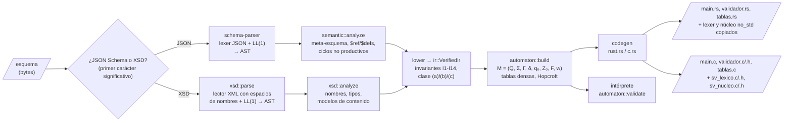
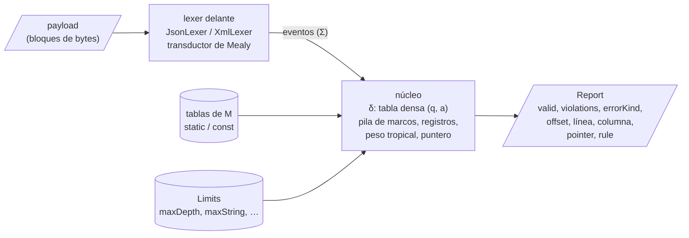
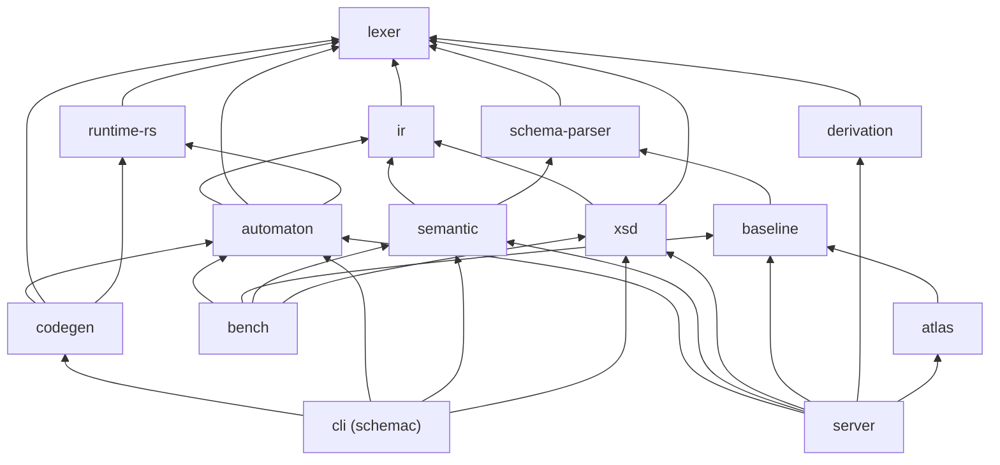
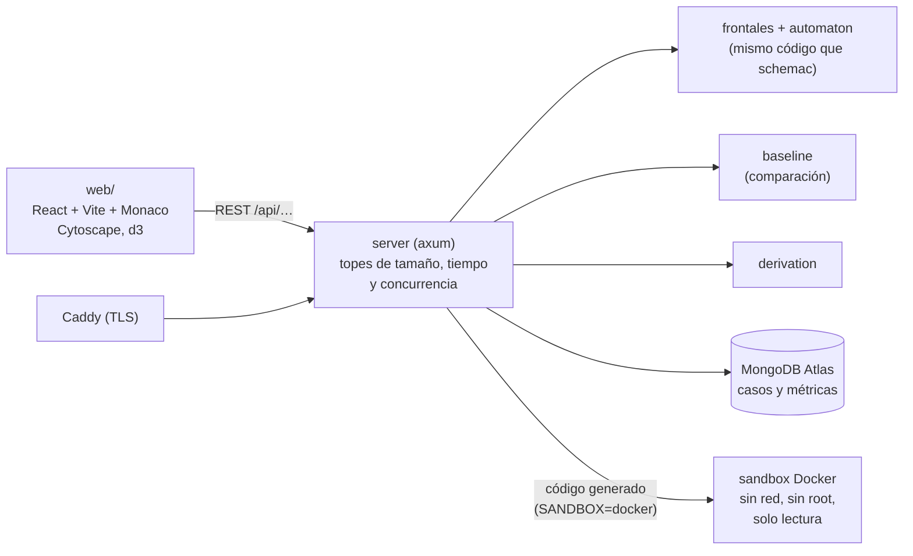

# Arquitectura del compilador

`schemac` traduce un esquema (JSON Schema o XSD) a un autómata de pila ponderado M (Fase 4) y emite un validador
nativo en Rust o C (Fase 5). Hay dos tiempos:

- **Compilación:** el esquema pasa por las cinco primeras fases.
- **Validación:** los bytes del payload pasan por el lexer y por las tablas de M en una sola pasada, sin árbol y
  sin reservar memoria.

Los diagramas son Mermaid, para que GitHub los dibuje. Las flechas entre crates son las dependencias normales que da
`cargo metadata` (sin las de pruebas).

## 1. Compilación: del esquema a M

| Fase | Crate | Entrada → salida | Documento |
| --- | --- | --- | --- |
| 1. Léxico | `lexer` | bytes → tokens (AFD de Mealy `no_std`, sin `alloc`; UTF-8, JSON, XML) | [fase1/lexico.md](fase1/lexico.md) |
| 2. Sintáctico | `schema-parser`, `xsd` (lector y parser) | tokens → AST del esquema (LL(1) descendente recursivo, profundidad ≤ 256, en un hilo con pila propia, D7) | [fase2/](fase2/) |
| 3. Semántico | `semantic`, `xsd` (análisis), `ir` | AST → `VerifiedIr`: `$ref` resuelto, ciclos rechazados, cada regla con su clase y estrategia | [fase3/ir.md](fase3/ir.md), [clasificacion.md](fase3/clasificacion.md) |
| 4. Autómata | `automaton` | `VerifiedIr` → `Automaton` (las tablas de M y su resumen) | [fase4/automata.md](fase4/automata.md) |
| 5. Código | `codegen` | `Automaton` → archivos Rust o C autocontenidos | [fase5/codegen.md](fase5/codegen.md), [codegen-c.md](fase5/codegen-c.md) |

El formato se decide por el contenido del esquema, no por su extensión. Las dos ramas se juntan en la IR: desde
`ir::VerifiedIr`, JSON Schema y XSD siguen el mismo camino (D13). La IR es la interfaz entre los frontales y el
constructor, y `schemac ir` la escribe en JSON estable (v2, D17).

## 2. Validación: el validador generado

- **Rust:** `runtime-rs` es el núcleo (`#![no_std]` sin `alloc`; solo depende de `lexer`). El intérprete
  (`automaton::validate`) y el binario generado usan **el mismo** núcleo: `codegen` copia sus fuentes junto a las
  tablas `static`.
- **C:** `runtime-c/sv_nucleo.c` es un port del mismo núcleo y de los lexers (`sv_validator_init`/`feed`/`finish`).
  Las tablas de los AFD van en `sv_lexico.c/.h`, volcadas del crate `lexer`, y las de M en `tablas.c`. El
  `validador.h` emitido da la API C del esquema: `sv_init`/`sv_feed`/`sv_finish`, con `sv_state_t` de tamaño fijo
  (D75).
- **Contrato:** la prueba diferencial de F5.3 comprueba que el intérprete, el Rust generado y el C generado (con
  ASan/UBSan) dan el mismo reporte en el corpus, en las mutaciones y en lo que encuentra el fuzzing.
- **Salida del binario:** una línea JSON y el código de salida 0 (válido), 1 (violaciones), 2 (malformado o límite)
  o 3 (interno) ([fase5/codegen.md](fase5/codegen.md)).

Los invariantes que vigilan las pruebas:

- O(n) en bytes y O(d) en pila;
- cero reservas (`sin_reservas.rs` en Rust, `nm -u` en el C);
- el mismo resultado con bloques de 1, 7 y 4 096 bytes;
- ninguna recursión sobre la entrada del usuario (D7).

## 3. Crates y dependencias

El diagrama omite las aristas que ya se siguen por otro camino. Por ejemplo, `cli` también depende directamente de
`ir`, `lexer` y `schema-parser`; `bench`, de `ir`, `schema-parser` y `runtime-rs`; y `server`, de `ir` y
`schema-parser` (lista completa:
`cargo metadata --no-deps`). `automaton` no depende de ningún frontal: `semantic`, `schema-parser`, `xsd` y
`baseline` solo entran en sus pruebas (F4-B1, D13).

| Crate | Papel |
| --- | --- |
| `lexer` | AFD de UTF-8, JSON y XML; `no_std` |
| `schema-parser` | parser LL(1) de JSON Schema y AST |
| `semantic` | meta-esquema, `$ref`, ciclos y bajada a la IR |
| `xsd` | frontal XSD: lector, parser, análisis y bajada |
| `ir` | IR común, verificación (`VerifiedIr`), clasificación, expresiones regulares (`ir::regex`) |
| `automaton` | construcción de M, minimización, exportación (resumen y DOT), intérprete |
| `runtime-rs` | núcleo del validador (`no_std`), límites, reporte, puntero, semianillo |
| `runtime-c` (no es crate de Cargo) | núcleo C11 equivalente |
| `codegen` | emisores Rust y C, opciones de límites |
| `cli` | `schemac`: `check`, `ir`, `automaton`, `compile`, `dot` |
| `baseline` | líneas base DOM: `serde_json` + `jsonschema` y libxml2 (feature) |
| `bench` | métricas, benchmarks, generador de payloads y mutaciones |
| `derivation` | árboles de derivación LL(1) de payloads |
| `atlas` | carga de casos y métricas en MongoDB Atlas |
| `server` | API REST (axum) de la aplicación web |
| `fuzz/` (fuera del workspace) | objetivos de cargo-fuzz (nightly) |

## 4. La aplicación (Fase 7)

Endpoints: `GET /api/health`, `POST /api/schemas`, `/api/automaton`, `/api/derivation`, `/api/compare`,
`GET /api/tests`, `POST /api/tests/run`, `POST /api/code` (ZIP con el código generado), `POST /api/validate` (lo
compila y ejecuta en el sandbox y lo compara con el intérprete) y `WS /ws/validate` (validación por bloques con el
núcleo `runtime-rs`). Están documentados en [fase7/servidor.md](fase7/servidor.md), [vistas.md](fase7/vistas.md),
[atlas.md](fase7/atlas.md) y [codigo.md](fase7/codigo.md). `POST /api/validate` usa el sandbox
([fase7/sandbox.md](fase7/sandbox.md)) solo si el servidor arranca con `SANDBOX=docker`. En la EC2 queda apagado
(503), así que la validación con el código generado se enseña en local ([fase7/codigo.md](fase7/codigo.md) §5). El
despliegue está en [fase7/despliegue.md](fase7/despliegue.md).

## 5. Interfaces compartidas

Cambiar cualquiera de estas interfaces necesita el visto bueno de las dos personas (D42):

| Interfaz | Dónde |
| --- | --- |
| IR y `VerifiedIr` | `crates/ir`, [fase3/ir.md](fase3/ir.md) |
| JSON v2 de `schemac ir` | D17, [fase3/bajada.md](fase3/bajada.md) |
| API C del validador | `crates/runtime-c/sv_nucleo.h`, el `validador.h` emitido, [fase5/codegen-c.md](fase5/codegen-c.md) |
| Línea JSON y códigos de los binarios | [fase5/codegen.md](fase5/codegen.md), [fase6/puntero.md](fase6/puntero.md) |
| API del servidor | [fase7/servidor.md](fase7/servidor.md) |
| Subconjunto y límites | [00-alcance.md](00-alcance.md) |
