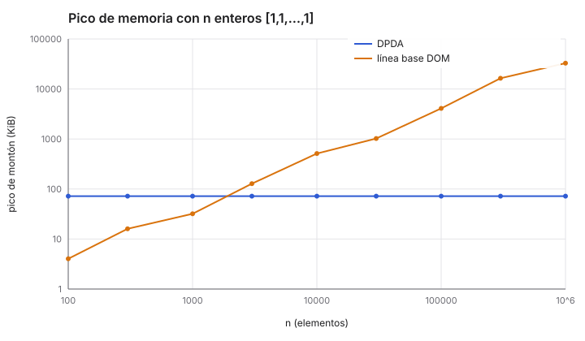
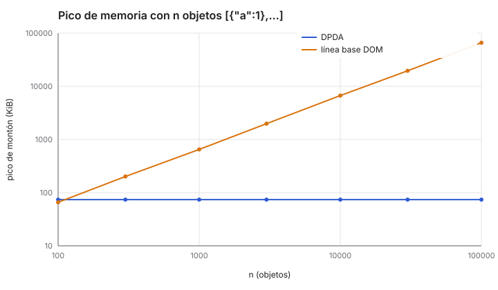
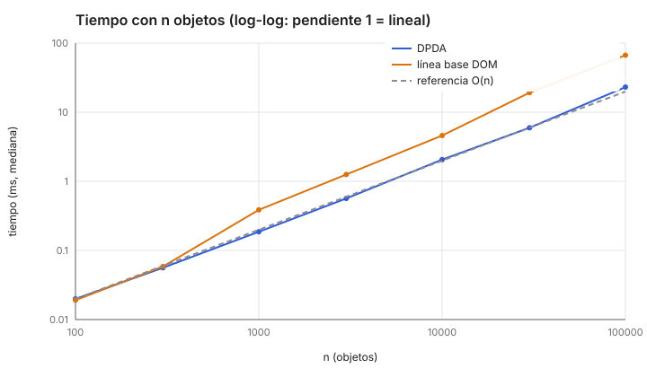

# Pruebas de bombeo y gráficas contra k (E1, D80)

E1 pide pruebas de bombeo u·vᵏ·x·yᵏ·z y casos extremos, con gráficas de tiempo, pila y memoria contra k. Este
documento las reúne. Las medidas completas del corpus están en [metricas.md](metricas.md) (F6.5).

```text
cargo run -p bench --release --bin metricas -- --bombeo-fino --csv target/metricas/bombeo.csv
cargo run -p bench --release --bin graficas -- target/metricas/bombeo.csv docs/fase6/graficas
cargo test -p bench --release --test bombeo        # pruebas del lema (deterministas, D1)
```

Los SVG de `graficas/` y su tabla [graficas/datos.md](graficas/datos.md) se generan con esas órdenes. Los tiempos
dependen de la máquina, así que **no** entran en `make docs-check`. Esta tanda se midió el 21 nov en el PC de
desarrollo (Windows 11, release, mediana de 11 repeticiones; memoria con `dhat`).

## 1. Por qué el bombeo

El lenguaje de los arreglos anidados `[ᵏ ]ᵏ` es el ejemplo clásico de un lenguaje **libre de contexto y no
regular**:

- **No es regular.** Para un AFD de p estados, la palabra `[ᵖ ]ᵖ` solo admite bombear corchetes de apertura (la
  parte bombeable está en los p primeros símbolos). Bombear desequilibra la palabra, así que el lema de bombeo
  para regulares falla.
- **Sí es libre de contexto.** Cumple el lema de bombeo para libres de contexto con u = x = z = ε, v = `[` e
  y = `]`.
- **Consecuencia:** un validador por expresiones regulares no puede reconocerlo. El DPDA sí, con una pila que
  crece con k.

Las otras dos familias miden el coste por elemento cuando la profundidad no crece: n enteros `[1,…,1]` y n
objetos `[{"a":1},…]`.

## 2. Pruebas del lema (`crates/bench/tests/bombeo.rs`, 7)

| Prueba | Qué comprueba |
| --- | --- |
| `anidado_se_acepta_para_todo_k_hasta_el_tope` | u·vᵏ·x·yᵏ·z con v = `[`, y = `]` es válido para **todo** k de 1 a 255 en el DPDA (y en la línea base, por muestreo). |
| `bombear_solo_v_o_solo_y_rompe_la_palabra` | `[ᵏ⁺¹ ]ᵏ` da `syntax` al acabar la entrada y `[ᵏ ]ᵏ⁺¹` en el `]` sobrante (offset 2k): es lo que haría un AFD que solo puede bombear un lado. |
| `pasar_el_tope_de_profundidad_es_un_limite` | Con k ≥ 257, `limit` justo en el byte 256 (`00-alcance.md` §4), sin leer el resto. |
| `pila_lineal_en_k_y_memoria_fija` | `stack_words(k) = w₀ + k·(w₁ − w₀)`: la pila es **afín en k**, O(d). La memoria reservada (los límites) cubre la profundidad 256. |
| `bombear_una_violacion_suma_k_en_el_semianillo_tropical` | u = `[`, v = `9,`, x = `0`, z = `]` con `maximum: 5`: el peso del recorrido es **exactamente k** (⊗ = suma). Coincide con la línea base. |
| `bombeo_con_v_e_y_no_vacios_y_recursion` | v = `[9,`, x = `[0]`, y = `]` con `prefixItems` y `items` recursivo: k niveles, k violaciones. |
| `bloques_de_cualquier_tamano_dan_lo_mismo` | Con bloques de 1, 7, 64 y 4096 bytes, el mismo reporte, también al pasar el tope. |

## 3. Gráficas

### 3.1 Tiempo contra k (`[ᵏ ]ᵏ`)

![Tiempo de validación de [ᵏ ]ᵏ contra k](graficas/anidado-tiempo.svg)

Los dos son lineales en k: cada byte se lee una vez. El DPDA tarda 13 µs con k = 255 y la línea base 40 µs. La
línea base construye un nodo del DOM por nivel; el DPDA hace una transición y un *push* o un *pop* de tamaño fijo.

### 3.2 Pila y memoria contra k

![Pila y memoria de [ᵏ ]ᵏ contra k](graficas/anidado-pila-memoria.svg)

- **Pila del DPDA** (verde): 32 B por nivel, exactamente lineal: 32 B con k = 1 y 8 160 B con k = 255. Es la
  pila O(d) de la definición del autómata. Se calcula de M (`stack_words`), no se estima.
- **Memoria reservada del DPDA** (azul discontinua): 72 KiB **fijos**, decididos por los límites (profundidad 256,
  claves no declaradas…) antes de leer el payload. El DPDA no pide memoria al validar: una sola asignación en
  total.
- **Línea base** (naranja): el pico de montón crece con k (37,8 KiB con k = 255), con una asignación por nivel.

### 3.3 Memoria contra n (log-log)





El DPDA queda **plano** en 72-74 KiB para cualquier n. La línea base crece en proporción a n: 32 MiB con 10⁶
enteros y 64,4 MiB con 10⁵ objetos (200 017 asignaciones). Con payloads pequeños (menos de unos 2 000 enteros o
100 objetos) la línea base usa **menos** memoria, porque los 72 KiB del DPDA son una reserva fija. El argumento no
es que el DPDA use menos memoria siempre, sino que **tiene una cota que no depende de la entrada**. Esa cota es la
que permite validar en streaming payloads de cualquier tamaño.

### 3.4 Tiempo contra n (log-log)



En log-log, una recta de pendiente 1 es tiempo lineal. El DPDA sigue la referencia O(n) (gris) en todo el rango,
de 10² a 10⁵ objetos. La línea base también es lineal, pero 2,9× más lenta con 10⁵ objetos (67 ms frente a
23 ms), porque reserva y libera un nodo por objeto. Con enteros pasa al revés, y conviene decirlo en el informe:
la línea base es entre 1,7× y 3,5× más rápida (1,7× con 10⁶), porque `serde_json` analiza números en un bucle muy optimizado y el
DPDA procesa los bytes de uno en uno con la tabla de transiciones. La diferencia de memoria (§3.3) se mantiene.

## 4. Casos extremos

Los casos `extreme` del corpus (`tests/cases/extreme/`) cubren:

- un número de 1 025 dígitos, que da `limit` por el lexema (`LEXEME_MAX` = 1 024);
- 257 niveles de anidamiento, que dan `limit` en el byte 256.

Los dos dan el mismo resultado en el DPDA, en la línea base y en Atlas (F7.2, 78/78). En F6.3 se añadieron 30
casos mutados (truncados, comas colgantes, escapes, UTF-8 inválido, claves repetidas…).

## 5. Lectura para el informe (E4)

- **Corrección del modelo:** el lema de bombeo se comprueba sobre el validador real, no solo en papel (§2).
- **Complejidad:** O(n) en tiempo (§3.1, §3.4) y O(d) en pila (§3.2), con memoria total acotada por los límites y
  no por la entrada (§3.3).
- **Peso tropical:** bombear una violación suma exactamente k al peso (§2), que es la semántica del semianillo
  (min, +) en modo de conformidad total.
- **Coste real:** el DPDA gana en memoria siempre que la entrada crece, y en tiempo cuando el DOM tiene muchos
  nodos (objetos). Con números puros, la línea base es más rápida (§3.4).
