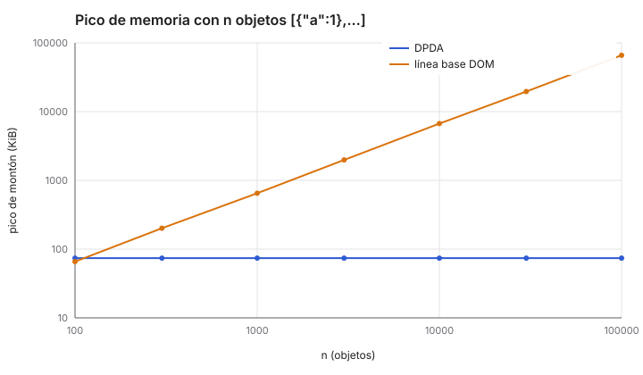
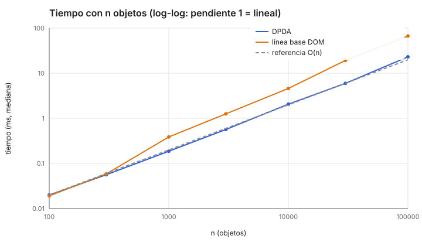

# Informe final

**Validación en tiempo real de esquemas JSON/XML mediante autómatas de pila ponderados**
Lenguajes Formales y Autómatas 2026-2 · Ingeniería de Sistemas y Computación, UPTC Sogamoso · Leonardo Mariño y
Bayron Fuentes

Entregable 4 del enunciado (§5): análisis de complejidad (O(n) en bytes y O(d) en pila; tamaño del autómata y
riesgo de explosión al determinizar), decisiones de diseño, manejo de errores y casos especiales, vulnerabilidades
detectadas y mitigadas, y resultados de las pruebas de bombeo. La documentación técnica (definición formal,
diagramas, gramáticas, arquitectura) es el entregable 1 y empieza en [README.md](README.md). Aquí se resume y se
remite a ella.

## 0. Resumen

`schemac` compila un esquema a un autómata de pila determinista ponderado M_S y emite un validador autocontenido
en Rust (`no_std`) o C11. Acepta JSON Schema (subconjunto de 2020-12) o XSD (subconjunto de 1.0). El validador lee
el payload en streaming, en bloques de cualquier tamaño, sin construir árbol y sin reservar memoria. Da un reporte
con el número de violaciones (el peso en el semianillo tropical), la clase del primer error, su posición (offset,
línea, columna y JSON Pointer o ruta XML) y la regla incumplida.

| Resultado | Valor | Dónde |
| --- | --- | --- |
| Tiempo de validación | lineal en n; ≈ 27-40 MB/s en el intérprete de tablas | §1.3 |
| Pila | lineal en la profundidad: 32 B por nivel en el esquema de bombeo | §1.3, §5 |
| Memoria | 72-78 KiB fijos, una sola reserva, para cualquier n (la línea base DOM: 64,4 MiB con 10⁵ objetos) | §1.3 |
| Tamaño de M | de 13 estados y 43 transiciones a 216 y 10 054 (XSD del pedido) | §2.1 |
| Explosión al determinizar | acotada: `limit` antes de crear el estado 4 097 o de pasar 2²⁰ entradas | §2.2 |
| Corrección | 78 casos del corpus; intérprete = Rust generado = C generado (con ASan/UBSan); veredicto = línea base | §6 |
| Pruebas | 836 en `make test`, 7 del lema de bombeo, fuzzing con cuatro objetivos | §5, §6 |

## 1. Análisis de complejidad

### 1.1 Validación: O(n) en bytes

El validador es la composición de dos autómatas deterministas
([fase4/automata.md](fase4/automata.md) §2):

1. **El lexer**, un transductor finito de Mealy (los AFD de la Fase 1). Lee cada byte **una vez**, hace O(1)
   trabajo y emite como mucho un número constante de eventos.
2. **M_S**, que consume esos eventos. Por evento hace una consulta a la tabla densa δ[q][a], las comprobaciones de
   la transición y a lo sumo una operación de pila.

Las comprobaciones de una transición están acotadas por el esquema, no por el payload:
- las numéricas cuestan O(|lexema| + |cota|), con el lexema ≤ 1 024 bytes, así que O(1) amortizado por byte;
- un `enum` numérico cuesta O(log k) comparaciones;
- las claves no declaradas se buscan en una región de como mucho 1 024 entradas.

El total es **O(n)** en bytes, con una constante que depende de S y no de la entrada.

**Independencia del troceado.** El lexer y M guardan todo su estado entre bloques. Validar con bloques de 1, 7,
64 o 4 096 bytes da el mismo reporte. Lo comprueban todas las pruebas del corpus, las de bombeo, la prueba
diferencial y el fuzzing.

### 1.2 Pila: O(d) y memoria fija

La pila solo crece con `{`, `[` o un elemento XML con contenido, y solo decrece con su cierre: es una pila
**visible** (automata.md §4.3, comprobado en cada `build`). Su altura es la profundidad de anidamiento d, y cada
marco tiene un tamaño fijo por esquema. El escalar abierto no se apila: en JSON hay como mucho uno abierto, así
que su estado de retorno es un registro finito.

La memoria que depende del esquema y de los límites es un bloque `state_words(límites)` que se reserva una vez,
antes de leer el payload ([fase4/runtime.md](fase4/runtime.md) §2). Fuera de él quedan unos registros de tamaño fijo
del núcleo: el lexema de 1 024 bytes, unas decenas de palabras y los 2 KiB de la ruta del puntero
([fase6/puntero.md](fase6/puntero.md) §2).

```
[ zona escalar | pila de marcos → … ← reserva de hashes (claves no declaradas, uniqueItems) ]
```

Con los límites por defecto son 72 KiB con el marco «cualquiera». Con 4 096 nombres en un objeto serían unos
202 KiB. Pasar la profundidad (256) es un error `limit`, nunca un desbordamiento. El núcleo es `#![no_std]` sin
`alloc`. `sin_reservas.rs` cuenta **cero** reservas entre `new` y `finish` en todos los casos del corpus con payload
y con 10⁵ niveles (subiendo `max_depth` para esa prueba). `nm -u` comprueba que el binario C no enlaza `malloc`.

### 1.3 Evidencia medida

Medidas de E1 y F6.5 ([fase6/bombeo.md](fase6/bombeo.md), [fase6/metricas.md](fase6/metricas.md)): Windows 11,
release, sin carga controlada, mediana de 11 repeticiones y memoria con `dhat`. Solo JSON: la línea base XML
(libxml2) corre en Docker y su memoria no la ve `dhat`. El DPDA es el intérprete de tablas, con el mismo núcleo que el
validador Rust generado. La línea base es `serde_json` + `jsonschema`, que construye el DOM.

![Tiempo de [ᵏ ]ᵏ contra k](fase6/graficas/anidado-tiempo.svg)

![Pila y memoria de [ᵏ ]ᵏ contra k](fase6/graficas/anidado-pila-memoria.svg)

| Familia | n o k | DPDA | Línea base | DPDA, pico | Línea base, pico (asignaciones) |
| --- | ---: | ---: | ---: | ---: | ---: |
| `[ᵏ ]ᵏ` | 255 | 13,2 µs | 40,5 µs | 72,0 KiB | 37,8 KiB (262) |
| n enteros `[1,…]` | 10⁶ | 73,2 ms | 43,4 ms | 72,0 KiB | 32,0 MiB (20) |
| n objetos `[{"a":1},…]` | 10⁵ | 23,1 ms | 66,7 ms | 74,0 KiB | 64,4 MiB (200 017) |





Lectura:

- **Tiempo lineal.** En log-log, el DPDA sigue una recta de pendiente 1 de 10² a 10⁶. Va a ≈ 27-40 MB/s
  (25-37 ns por byte), sin depender de n ni de la profundidad.
- **Memoria acotada por una constante.** El DPDA queda plano en 72-74 KiB. La línea base crece con n: 16× la
  entrada con enteros y unas 80× con objetos. Con payloads pequeños (menos de unos 2 000 enteros, unos 4 KB, o
  unos 100 objetos, menos de 1 KB) la línea base usa menos memoria, porque la del DPDA es una reserva fija. Lo que importa es que esa reserva **no depende de la
  entrada**, y eso es lo que permite validar en streaming payloads de cualquier tamaño.
- **El DPDA no siempre es más rápido.** Con 10³ objetos o más, o con k ≥ 64 niveles, es 2-3× más rápido, porque
  la línea base reserva un nodo por valor. Con pocos objetos (100-300) o poca profundidad (k ≤ 16) van parejos o
  gana la línea base. Con arreglos de números, `serde_json` es entre 1,5× y 3,5× más rápido. Una causa probable,
  que no se midió, es que su bucle de números está muy optimizado y el DPDA hace una consulta a δ por byte. La
  mejora natural serían los saltos directos, que se recortaron en D46.
- **Validadores generados.** Medición del 21 nov en Linux (Intel i5-1035G1, sin otra carga), con el esquema
  `usuarios` sin `maxItems` y un payload válido de 129,6 MB (2·10⁶ usuarios) leído por stdin. Se tomó la mediana
  de 5 corridas:

  | Binario | Tiempo | Velocidad | Pico de memoria residente |
  | --- | ---: | ---: | ---: |
  | Rust (`rustc -O`) | 3,65 s | 35,5 MB/s | ≈ 2,0 MiB |
  | C (`cc -O2`) | 4,93 s | 26,3 MB/s | ≈ 1,3 MiB |

  El pico se midió con `wait4` desde un lanzador mínimo, y es el mismo con un payload de 5,6 KB que con el de
  129,6 MB. Para comparar, un proceso vacío (`/bin/true`) ocupa 1,2 MiB. El validador entero, con sus tablas y
  su estado fijo, cabe en lo que ocupa un proceso más unos cientos de KiB, sea cual sea la entrada. Una prueba
  anterior con un payload inválido de 122 MB dio el puntero correcto (`/users/2000000`).

### 1.4 Construcción: acotada antes de reservar

El compilador no tiene el requisito de O(n), pero sí el de no colgarse ni agotar la memoria con un esquema
hostil. Todo lo que crece se cuenta **antes** de reservarlo (automata.md §6.6, §7 y §15):

- |Q|·|Σ| más las tablas que crecen con los productos ≤ 2²⁰ entradas (`BuildError::Limit`);
- 4 096 estados por producto o por AFD de `pattern` (`ProductLimit`);
- 2²⁴ pasos para los cierres de `$ref`/`allOf` y 2²⁶ palabras para la determinización de un `pattern`;
- 4 096 posiciones por `pattern` y 4 096 partículas por modelo de contenido XSD (D26).

En tiempo, la construcción es O(2²⁰ + n + W·ℓ), con n el tamaño de la IR, W el trabajo de los cierres y ℓ la
longitud del nombre más largo. El peor JSON Schema que se encontró, uno de 16 MiB construido a propósito, tarda
unos 5 s en release. En XSD, la comprobación de UPA del frontal tarda entre 7 y 28 s con 16 MiB. Por eso el
servidor limita la subida a 1 MiB y pone su propio tope de 10 s ([fase7/servidor.md](fase7/servidor.md) §3).

## 2. Tamaño del autómata y riesgo de explosión al determinizar

### 2.1 Tamaños medidos

`schemac automaton` da el resumen. Valores del corpus ([fase6/metricas.md](fase6/metricas.md) §4):

| Esquema | Estados | Transiciones | Nota |
| --- | ---: | ---: | --- |
| `extreme-depth-01`, `malformed-json-syntax-01` (los más pequeños) | 13 | 43 | solo las partes fijas y «cualquiera» |
| `objeto-cerrado` | 24 | 77 | la dorada contada a mano (automata.md §8) |
| `arbol-recursivo` | 41 | 308 | recursión por `$ref`: Q finito, pila no acotada |
| `invalid-missing-required-01` (JSON) | 50 | 326 | el JSON más grande de la tabla de F6.5 (20 nov); los casos generados después llegan a 117 y 1 740 |
| pedido (XSD) | 216 | 10 054 | Glushkov con contadores, AFD de `xs:decimal`; 257 y 12 009 antes de Hopcroft |

|δ| = |Q|·|Σ| exactamente, porque δ es total. El tamaño lo dominan las partes finitas: los tries de nombres, los AFD
de los espacios léxicos de XSD y los de `pattern`. Hopcroft (F4.3) las minimiza y deja el pedido en 216 estados.
M entero no se minimiza: un DPDA no tiene, en general, un mínimo canónico (automata.md §17).

### 2.2 Dónde puede explotar y qué lo impide

| Fuente | Peor caso teórico | Qué hace el compilador | Evidencia |
| --- | --- | --- | --- |
| `pattern` → AFD (subconjuntos sobre Glushkov) | 2^m estados con m posiciones. `^(a\|b)*a(a\|b){k}$` necesita 2^(k+1): recordar las k+1 últimas letras | Cuenta los estados al crearlos. El 4 097.º es `limit` en la ubicación del `pattern`, con el trabajo acotado en 2²⁶ palabras | Con `schemac automaton`: k = 8 da 513 estados, k = 10 da 2 049 y k = 11 da `limit` ([fase4/pattern.md](fase4/pattern.md) §6, `crates/automaton/tests/pattern.rs`) |
| Productos: `allOf`, `$ref` con reglas hermanas, varios `pattern` sobre la misma cadena | producto de los tamaños | El producto cuenta sus estados con tope de 4 096 (`ProductLimit`). Sin simulación paralela (recorte 3) | 15 `pattern` primos en `allOf` dan `limit` en el estado 4 097 (automata.md §18) |
| `anyOf`, `oneOf`, `not` | producto de las ramas | **No** se hace el producto de estados. Cada rama escribe en un contador de salida y una puerta combina las salidas al cerrar la instancia (pila visible, cerrada bajo booleanos; D63) | 2 000 diamantes de `anyOf` con un número constante de marcos |
| `{m,n}` y `maxOccurs` | desenrollar m o n copias | En XSD, el Glushkov lleva k contadores por marco y no desenrolla (D57). En `pattern`, como mucho 4 096 posiciones tras expandir | `a{999999999}` y `(a{100}){100}` dan `limit` |
| Muchos nombres o literales | un estado por byte de nombre | Trie compartido, una clase de Σ por carácter usado (|Σ| crece con la suma, no con el producto) y presupuesto de 2²⁰ | 4 096 nombres por objeto compilan; 4 097 dan `limit` |

La consecuencia de diseño: la explosión es un **resultado reportable**, no un fallo. El esquema se rechaza al
compilar con `limit`, su ubicación y el número alcanzado. Nunca se construye un autómata enorme ni se queda
esperando. El fuzzing de esquemas (`esquema_json`, `esquema_xsd`) comprueba que ningún esquema hace entrar en
pánico ni desbordar la pila a las Fases 2-4.

## 3. Decisiones de diseño

El registro completo (D1-D80) está en [`tasks/plan-general.md`](../tasks/plan-general.md). Las que dan forma al
resultado:

| Tema | Decisión | Por qué |
| --- | --- | --- |
| Pesos | Semianillo tropical (ℕ ∪ {∞}, mín, +, ∞, 0); cada `Constraint` incumplida pesa 1 y un malformado o un límite, ∞ (D4, F4-U3) | El peso cuenta violaciones. ∞ absorbe, así que un malformado nunca se confunde con muchas violaciones. Saturar en u64 conserva las leyes del semianillo (proptest) |
| Σ | Eventos del lexer, no bytes: el lexer va delante como transductor (F4-U1) | Separa lo regular (tokens, UTF-8, escapes) de lo libre de contexto, y |Σ| sale pequeño (14 eventos, la clase «otro» y una por carácter usado) |
| Registros | Acotados y saturados: máscara de claves, contadores, lexema ≤ 1 024 (automata.md §1) | Así el control es finito y M es un autómata de pila en sentido estricto. Los números se comparan sobre el lexema decimal exacto, nunca como `f64` |
| Una IR para los dos lenguajes | JSON Schema y XSD bajan a `ir::VerifiedIr`; `automaton` no conoce los frontales (D3, D13) | Una sola construcción de M para los dos |
| Clase (c) | `pattern` → AFD dentro de M (D61-D62); combinadores → salidas por rama y puertas (D63); `uniqueItems` → verificación diferida por hash canónico (D64) | Todo en una pasada y con memoria fija. Lo que no es libre de contexto (`uniqueItems`) se decide al cerrar el arreglo |
| XML | En la teoría, Γ incluye el nombre del elemento, porque el esquema fija un alfabeto finito de nombres (gramatica-xml.md §4). En la implementación, el marco guarda el hash del QName de apertura y lo compara con el de cierre (runtime.md §4). Glushkov con contadores; UPA conservadora (D25, D57) | El emparejamiento de etiquetas no es libre de contexto sobre nombres arbitrarios; con N finito, sí |
| Un solo ejecutor | El intérprete y el código generado comparten el núcleo `no_std` (D51, D74). El C es un port función por función (D75) | La prueba diferencial puede exigir igualdad exacta de reportes |
| Código generado | Tablas densas `static` y núcleo copiado; compila con `rustc` o `cc` sin Cargo ni dependencias (D46, D74, D75) | Autocontenido, para el sandbox y la descarga |
| Recursión | Nada recorre entrada del usuario con recursión: pilas explícitas o un hilo con `stack_size` (D7) | Un esquema o payload de 10⁵ niveles no desborda la pila nativa |
| Determinismo de las pruebas | Nada de umbrales de tiempo en `cargo test`; las mediciones van a `bench` (D1) | Pruebas reproducibles en cualquier máquina |
| `unsafe` | Prohibido, salvo el asignador contador de una prueba (D52) | Por eso el C no entra en libFuzzer por FFI y se comprueba por reproducción (D79) |

Recortes, todos documentados:
- solo tablas densas, sin saltos directos (D46);
- `enum`/`const` de objetos o arreglos se rechazan al compilar (recorte 2, D64);
- sin simulación paralela de varios `pattern` más allá del tope de producto (F4-U11);
- WASM, que era opcional, no se hizo.

## 4. Manejo de errores y casos especiales

### 4.1 El reporte del payload

| Clase (`errorKind`) | Peso | Cuándo | Código de salida del binario |
| --- | --- | --- | --- |
| — (válido) | 0 | w ∈ L(S) | 0 |
| `schema` | k ≥ 1 | bien formado; viola k restricciones | 1 |
| `lexical` | ∞ | byte o token imposible: UTF-8 inválido, `<!DOCTYPE`, entidad desconocida, número mal escrito | 2 |
| `syntax` | ∞ | la gramática o la buena formación: coma colgante, entrada truncada, clave repetida, etiqueta de cierre que no empareja | 2 |
| `limit` | ∞ | profundidad, cadena, lexema, claves, `uniqueItems`, referencias XML, tamaño o tiempo | 2 |
| `internal` | ∞ | tablas incoherentes (defensa en profundidad; no ocurre con las de `schemac`) | 3 |

**El primer error** lleva el offset en bytes (u64 exacto), la línea y la columna (u32 saturantes, D9), el puntero y
la regla con su palabra clave:

- **Offset:** es el del comienzo del evento que lo detecta. Por ejemplo, el `}` para `required`, la comilla de
  apertura de una clave repetida o el comienzo de un número para `integer`.
- **Puntero:** es el de la instancia abierta en ese evento, `/users/1` o `/pedido/linea`
  ([fase6/puntero.md](fase6/puntero.md)). Se calcula en la misma pasada, con 1 KiB fijo. Si no cabe, se recorta al
  antepasado más profundo y se marca `pointerTruncated`.
- **Si hay un error de peso ∞,** el primero es ese.

**Dos modos sobre el mismo M** (automata.md §5):
- **Conformidad total:** suma todas las violaciones y sigue leyendo. Una clave prohibida suma 1 y su valor se
  recorre con los marcos «cualquiera».
- **Fallo temprano:** se detiene en la primera transición con peso > 0 e informa de la comprobación más barata de
  esa transición.

Los dos dan el mismo veredicto en todo el corpus. Si una violación aparece antes de un malformado, el fallo
temprano da `schema` y la conformidad total da `syntax`. Es el comportamiento elegido en F6.3-P1, opción (a).

### 4.2 Errores del esquema

`schemac check`, `ir`, `automaton` y `compile` informan los errores del esquema con línea y columna y salen con 1.
Los informan todos dentro de cada etapa, pero una etapa que falla detiene las siguientes:
- sintaxis LL(1);
- meta-esquema;
- `$ref` sin resolver;
- ciclos que no consumen entrada (D12);
- palabras clave fuera del subconjunto, con su clase y por qué (D6);
- en XSD: nombres, tipos, facetas, UPA y partículas.

La lista se trunca en el servidor. Un fallo de lectura o de argumentos da 2, y un pánico o una IR que no pasa
`verify`, 3. El formato del esquema se decide por su contenido: `<` tras un BOM y espacios es XSD (D22).

### 4.3 Casos especiales

- **Números.** Se comparan sobre el lexema decimal exacto: `1.0` es entero, `minimum` y `multipleOf` no pierden
  precisión, `1e999999999999999999` no se expande y `-0` es 0. Un lexema de más de 1 024 bytes es `limit` solo si
  una comprobación lo lee. Las facetas de `xs:float`/`xs:double` usan umbrales IEEE exactos, y los valores NaN e INF
  del payload se tratan como en XSD (D57). En el esquema, NaN e INF en una faceta se rechazan (D24).
- **Cadenas.** `minLength`/`maxLength` cuentan puntos de código después de decodificar los escapes. Los pares
  sustitutos sueltos son error léxico.
- **Claves.** Una clave repetida es malformado en cualquier objeto, declarada o no (D2): con la máscara de bits si
  está declarada y con hash si no. Un hijo puede repetir las claves del padre.
- **BOM.** Se ignora un BOM UTF-8 al principio. Un prefijo incompleto es error en el offset 0 (D10).
- **XML.**
  - Solo las 5 entidades predefinidas y las referencias de carácter.
  - Los fines de línea y los valores de atributo se normalizan como en XML 1.0 §2.11 y §3.3.3.
  - El nombre de cierre se compara con el de apertura por hash del QName.
  - Los espacios de nombres del payload se comparan por nombre local.
  - La declaración `<?xml?>` solo se admite al principio y en UTF-8.
- **Anotaciones.** `title`, `description`, `xs:annotation` y los atributos de otros espacios de nombres se aceptan
  y se ignoran (D23, D34).

## 5. Resultados de las pruebas de bombeo

El lenguaje {`[ᵏ ]ᵏ`} es el ejemplo de libre de contexto y no regular. Para un AFD de p estados, la palabra
`[ᵖ ]ᵖ` solo deja bombear corchetes de apertura y desequilibra la palabra. Cumple el lema de los libres de
contexto con u = x = z = ε, v = `[` e y = `]`. E1 lo comprueba **sobre el validador real** con 7 pruebas
deterministas, todas en JSON y con el bombeo de `[`/`]` ([fase6/bombeo.md](fase6/bombeo.md) §2, `crates/bench/tests/bombeo.rs`):

| Prueba | Resultado |
| --- | --- |
| u·vᵏ·x·yᵏ·z con v = `[`, y = `]` | Válido para **todo** k de 1 a 255 en el DPDA, y en la línea base por muestreo |
| Bombear un solo lado | `[ᵏ⁺¹ ]ᵏ` da `syntax` al acabar la entrada; `[ᵏ ]ᵏ⁺¹`, en el `]` sobrante (offset 2k) |
| Pasar el tope | Con k ≥ 257, `limit` exactamente en el byte 256, sin leer el resto |
| Pila contra k | `stack_words(k) = w₀ + k·(w₁ − w₀)`: afín en k. Con este esquema, 32 B por nivel (8 160 B con k = 255), dentro de la memoria fija |
| Peso contra k | Con `maximum: 5`, bombear v = `9,` da **exactamente k** violaciones: ⊗ es la suma del semianillo. Coincide con la línea base |
| v e y no vacíos con recursión | v = `[9,`, x = `[0]`, y = `]` con `prefixItems` e `items` recursivo: k niveles, k violaciones |
| Troceado | Mismo reporte con bloques de 1, 7, 64 y 4 096 bytes, también al pasar el tope |

Las gráficas de §1.3 son las de E1:
- el tiempo crece linealmente en k y en n;
- la pila del DPDA crece 32 B por nivel;
- su memoria total queda fija;
- la memoria de la línea base crece con la entrada.

**Casos extremos** (`tests/cases/extreme`):
- un número de 1 025 cifras da `limit` por el lexema;
- 257 niveles dan `limit` en el byte 256;
- 10⁵ niveles con un `$ref` recursivo y 2²⁰ `[` dan `limit` sin desbordar nada (`mitigaciones.rs`);
- 122 MB por stdin, a memoria constante (§1.3).

## 6. Vulnerabilidades detectadas y mitigadas

### 6.1 Las que pide el enunciado

Detalle y pruebas en [fase6/mitigaciones.md](fase6/mitigaciones.md).

| Ataque | Mitigación | Prueba |
| --- | --- | --- |
| **ReDoS en `pattern`** (`^(a+)+$` con `aaaa…!`) | `pattern` es un AFD mínimo dentro de M: un paso de δ por carácter, sin vuelta atrás. Las retrorreferencias, el *lookaround* y los cuantificadores perezosos se rechazan en la Fase 3, porque no son regulares o no tienen sentido en un AFD | Los cinco patrones clásicos dan ≤ 40 estados y validan 10⁵ `a` en una pasada (`pattern_como_afd`) |
| **Desbordamiento de pila por anidamiento** | El validador no usa la pila nativa: la pila de M es un arreglo fijo, y pasar `maxDepth` (256) es `limit`. Los parsers del compilador son iterativos o corren en un hilo con `stack_size` (D7) | 10⁵ niveles con `$ref` y 2²⁰ `[` dan `limit` (`ref_ciclico`); `extreme-depth-01` |
| **XXE y expansión de entidades** (billion laughs, entidades de parámetro) | No hay DTD: el lexer rechaza `<!DOCTYPE` antes de leer ninguna declaración (D8). Solo existen las 5 entidades predefinidas. `maxXmlRefs` acota las referencias de carácter. Nada abre archivos ni red | `dtd_y_entidades`, `malformed-xml-billion-laughs-01`; un XSD con DOCTYPE tampoco se lee |
| **`$ref` cíclicos** | Los ciclos que no consumen entrada se rechazan en la Fase 3, aunque sean inalcanzables (D12). Los productivos son un marco recursivo de M acotado por `maxDepth` | `ref_ciclico`, `tests/schemas/semantic-error/ciclo-*` |
| **Ejecución de código generado** | Sandbox Docker (D68): sin red, sin root, sistema de archivos de solo lectura, límites de memoria, CPU y procesos, tiempo doble con `docker kill`, entrada por tar y órdenes fijas. Lo que se emite son tablas y cadenas escapadas. La revisión de que ningún esquema pueda inyectar código en lo emitido es parte de E3. `POST /api/validate` (F7.5, D81) compila y ejecuta lo emitido solo dentro del sandbox, y solo si el servidor arranca con `SANDBOX=docker`; en la EC2 queda apagado ([fase7/codigo.md](fase7/codigo.md) §5) | `scripts/test-sandbox.ps1` (8 pruebas con contenedores reales) |

### 6.2 Las que encontraron las revisiones de seguridad

Las tareas de las Fases 4-7 hechas con `/autodev` pasaron por `security-auditor` (D35). Las que se hicieron sin
`/autodev`, desde F4.6, tuvieron como mucho una revisión de corrección, y algunas ninguna. Su revisión de seguridad
es E3 (§6.3). Lo que se encontró y cómo se cerró:

| Hallazgo | Riesgo | Arreglo |
| --- | --- | --- |
| `automaton::validate` reservaba memoria según el payload (F4D-M3) | Un XSD con marcos de 3 KB y 1 MB de `<` pedían 3,2 GB y abortaban el proceso | La memoria sale de los límites, no del payload (`state_words`, F4.6): `limit`, nunca un aborto |
| Construcción del autómata sin presupuesto (F4D-M1, F4D-M2, F4E-M1 y otros de la misma revisión) | XSD de 1-14 MB construidos a propósito que pedían hasta 1,4 GB o tardaban más de 10 s | Todo se cuenta antes de reservar (§1.4). Los mismos repros: 1,4 GB → 43 MB (F4D-M2), 11,4 s → 0,30 s (F4E-M1), 32,7 s → 0,6 s (`s2000.xsd`), o `limit` |
| Servidor: conexiones lentas y cuerpos *chunked* de 1 byte (F7.1 SEC-H1, SEC2-H1) | Retener memoria con pocas conexiones | Plazo de lectura de 10 s, búfer contiguo y 32 MiB de cuerpos en vuelo en total ([fase7/servidor.md](fase7/servidor.md) §3) |
| Esquemas hostiles en la línea base (F6.7a SEC-M1, F6.7b) | `jsonschema` sin tope de CPU; libxml2 acumula todos los errores (12 MB → 962 MB) | Tope de violaciones y de mensajes; libxml2 no está en el servidor (solo en Docker, para las pruebas). **Parcial:** en `/api/compare`, `jsonschema` no tiene tope de CPU propio. Pasado el tope de 10 s el cliente recibe 504, pero el hilo sigue y conserva su permiso. Lo acotan la subida de 1 MiB y la concurrencia de 2 ([fase7/pendientes.md](fase7/pendientes.md) §15) |
| Frontal XSD sin límites de memoria propios (5.2 SEC-M1/M2) | El AST llega a ≈ 34× la entrada | Profundidad acotada; en el servidor, subida de 1 MiB y concurrencia 2; `mem_limit` del contenedor (D71) |
| Colisiones de hash en claves y `uniqueItems` | Fabricar un falso «repetido» | SipHash-1-3 con clave y dominios separados por tipo de valor (F4.5b). Un choque solo rechaza, salvo bajo `not` |

### 6.3 Lo que queda

- **Clave de hash pública.** Los binarios de `schemac compile` usan la clave por defecto. Con ella, quien escribe
  el payload puede fabricar un choque (unas 2³² operaciones) que solo rechaza su propio payload. Con `not` sobre
  `uniqueItems`, en cambio, podría hacer aceptar un arreglo que el esquema rechaza. Arreglo propuesto: una clave
  aleatoria al arrancar el binario ([fase6/pendientes.md](fase6/pendientes.md) §31, para E3).
- **Choque de hash en el nombre de cierre XML.** El nombre de cierre se compara por hash del QName (runtime.md §4).
  Con la clave pública, quien escribe el payload podría buscar dos nombres con el mismo hash (unas 2³² operaciones)
  para que se acepte una etiqueta de cierre que no empareja. Se cierra con la misma clave aleatoria.
- **Tiempo de compilación y hilos.** `automaton` no tiene reloj. El servidor responde 504 a los 10 s, pero no puede
  cancelar el hilo, que sigue hasta terminar con su permiso de concurrencia ([fase7/pendientes.md](fase7/pendientes.md)
  §12 y §15). El arreglo propuesto es compilar en un proceso aparte con límites de CPU y memoria.
- **El socket de Docker.** Para encender el sandbox, el servidor necesita `/var/run/docker.sock`, y quien controla
  ese socket controla el anfitrión. Lo mitigan las órdenes fijas en el código ([fase7/sandbox.md](fase7/sandbox.md)
  §5). Por eso en la EC2 `POST /api/validate` queda apagado ([fase7/codigo.md](fase7/codigo.md) §5).
- **Revisión consolidada.** La revisión de seguridad de las Fases 4-7 (E3) queda por hacer. F7.5 ya está hecha,
  así que puede empezar, e incluirá sus rutas nuevas: `POST /api/code`, `POST /api/validate` y `WS /ws/validate`.
- **Fuzzing.** Fueron 10 minutos por objetivo, sin fallos. Es una comprobación, no una garantía: conviene repetirlo
  en E3 y con cada cambio del núcleo.

## 7. Verificación

- **Corpus** ([`tests/README.md`](../tests/README.md)): 78 casos con esquema, payload y resultado esperado: 22
  válidos, 30 inválidos, 16 malformados, 8 fuera del DPDA puro y 2 extremos. El intérprete da exactamente lo
  esperado. El veredicto coincide con la línea base JSON en todos los casos JSON; la clase del error difiere en
  uno (`extreme-big-number-01`). Están cargados en MongoDB Atlas (F7.2), y `POST /api/tests/run` da 78/78. La
  carpeta `pumping` del corpus está vacía: el bombeo se genera en `crates/bench` (§5).
- **Prueba diferencial** (F5.3, [fase5/codegen-c.md](fase5/codegen-c.md)): el intérprete, el Rust generado y el
  C generado (con ASan/UBSan) dan el mismo reporte en el corpus, en las mutaciones de F6.3, en payloads sintéticos
  y en lo que encuentra el fuzzer, con bloques de 1, 7 y 4 096 y los dos modos.
- **Propiedades (proptest):** las leyes del semianillo, el puntero del primer número negativo, `anyOf: [S]` ≡ S, el
  AFD de `pattern` igual a `Regex::matches`, y `uniqueItems` frente a un oráculo.
- **Fuzzing** ([fase6/fuzzing.md](fase6/fuzzing.md)): cuatro objetivos con cargo-fuzz (payloads JSON contra la
  línea base, payloads XML, esquemas JSON y XSD). Sin fallos en la corrida de humo ni en la de 10 minutos por
  objetivo del 21 nov. En esta última fueron 55 669, 132 773, 226 223 y 221 592 ejecuciones, y quedaron corpus de
  1 060, 724, 2 412 y 2 345 entradas. Los payloads del corpus (hasta 1 000 por formato) se reprodujeron después en
  la prueba diferencial, con el mismo reporte en el intérprete, el Rust y el C.
- **Generación:** 20 válidos generados desde la IR (F5.4) y 30 inválidos o malformados por mutación (F6.3), todos
  con doble oráculo: el DPDA y la línea base.
- **Toda la verificación es local** (D32): `make lint` (rustfmt, clippy `-D warnings`, clang-format,
  `unsafe-check`), `make test` (836 pruebas) y `make docs-check`.

## 8. Conclusiones

El subconjunto de JSON Schema y XSD del alcance se reconoce con un autómata de pila determinista ponderado:
- las restricciones (a) son transiciones;
- las (b) son registros acotados en el marco;
- las (c) son AFD dentro de M, salidas por rama combinadas al cerrar, o verificación diferida.

El peso tropical convierte el reconocimiento en un conteo de violaciones sin cambiar el autómata, y el lema de
bombeo comprobado sobre el validador real confirma lo que dice la teoría: hace falta una pila, crece con k, y nada
más crece. En la práctica eso da validación lineal en una pasada, con memoria fija decidida antes de leer el
payload. La ventaja sobre un validador DOM no es la velocidad en todos los casos: con números puros `serde_json`
es más rápido. La ventaja es que la memoria tiene una cota que no depende de la entrada.
