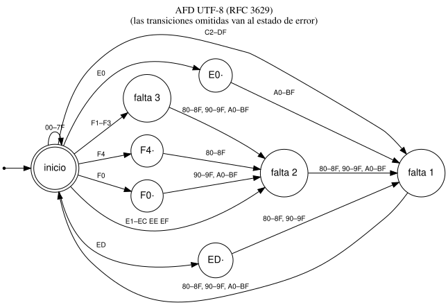
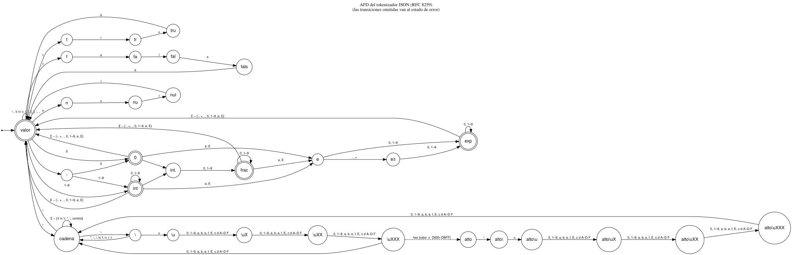
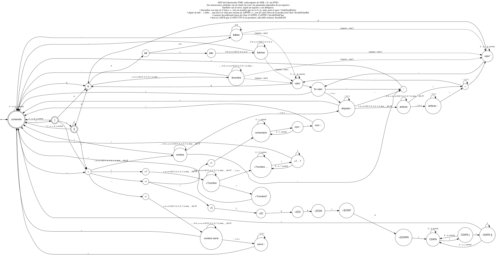
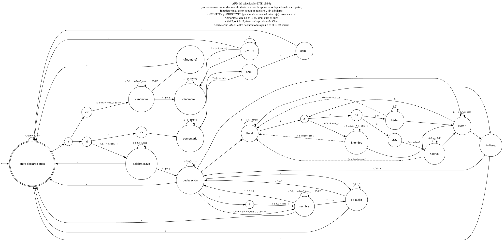

# Fase 1 — Análisis léxico

> Enunciado, §3: «Alfabeto (bytes UTF-8), delimitadores y tokens de JSON y XML; AFD del tokenizador en streaming
> (números, cadenas con escapes, literales, etiquetas); gramáticas regulares y diagramas de autómatas; lexer del
> propio esquema.»

Código: `crates/lexer` (`utf8.rs`, `json.rs`, `xml.rs`, `table.rs`, `dot.rs`) y `crates/dtd/src/lexer.rs`.
Diagramas: los genera `schemac dot <utf8|json|xml|dtd>` a partir de las mismas tablas que ejecuta el lexer.

## 1. Alfabeto

El validador lee **bytes**, no caracteres: el alfabeto de entrada es

  Σ_b = {0x00, …, 0xFF}.

Ninguna tabla tiene 256 columnas. Cada AFD agrupa los bytes en **clases de equivalencia**: dos bytes van a la misma
clase si ninguna transición del AFD los distingue. La función `CLASS: [u8; 256]` de cada módulo da la clase de cada
byte y `TABLE[estado][clase]` da la transición. Las dos son `static` y se construyen con `const fn` al compilar.

| AFD | Módulo | Estados (con el de error) | Clases de bytes |
| --- | --- | ---: | ---: |
| UTF-8 | `lexer::utf8` | 9 | 12 |
| JSON | `lexer::json` | 32 | 31 |
| XML | `lexer::xml` | 42 | 29 |
| DTD | `dtd::lexer` | 27 | 28 |

La decodificación UTF-8 forma parte del análisis léxico: los AFD de JSON, XML y DTD corren **en producto** con el
AFD UTF-8 dentro de las cadenas, los nombres y el texto. Un punto de código mal codificado es un error léxico y
nunca llega a las fases siguientes.

## 2. AFD de UTF-8 (RFC 3629)



El autómata acepta **exactamente** las secuencias UTF-8 bien formadas (tabla 3-7 de Unicode). Sus estados son:

| Estado | Significado |
| --- | --- |
| `inicio` (inicial y único de aceptación) | frontera entre caracteres |
| `falta 1`, `falta 2`, `falta 3` | faltan 1, 2 o 3 bytes de continuación (80–BF) |
| `E0·` | tras `E0`: el segundo byte debe ser A0–BF (si no, sería una forma sobrelarga de 3 bytes) |
| `ED·` | tras `ED`: el segundo byte debe ser 80–9F (si no, sería un sustituto U+D800–DFFF) |
| `F0·` | tras `F0`: el segundo byte debe ser 90–BF (si no, sería una forma sobrelarga de 4 bytes) |
| `F4·` | tras `F4`: el segundo byte debe ser 80–8F (si no, el valor pasaría de U+10FFFF) |
| `error` | sumidero |

Las 12 clases son: `00–7F`, `80–8F`, `90–9F`, `A0–BF`, `C0 C1 F5–FF` (nunca válidos), `C2–DF`, `E0`,
`E1–EC EE EF`, `ED`, `F0`, `F1–F3` y `F4`. Las secuencias sobrelargas (`C0 80`, `E0 80 80`), los sustitutos y los
valores por encima de U+10FFFF se rechazan **por construcción**: no hay ninguna transición que los acepte.

`Utf8Decoder` es el AFD más un registro de 32 bits con el punto de código parcial: ocupa 8 bytes y nunca reserva
memoria.

**Gramática regular equivalente** (lineal por la derecha; `I` es el símbolo inicial y la producción `I → ε`
refleja que `inicio` es de aceptación):

```
I  → a I        a ∈ 00–7F
I  → b C1       b ∈ C2–DF
I  → E0 E0'  |  c C2  (c ∈ E1–EC, EE, EF)  |  ED ED'  |  F0 F0'  |  d C3  (d ∈ F1–F3)  |  F4 F4'
I  → ε
E0' → x C1      x ∈ A0–BF
ED' → x C1      x ∈ 80–9F
F0' → x C2      x ∈ 90–BF
F4' → x C2      x ∈ 80–8F
C3 → x C2       x ∈ 80–BF
C2 → x C1       x ∈ 80–BF
C1 → x I        x ∈ 80–BF
```

Cada no terminal es un estado del AFD y cada producción `A → x B` es la transición δ(A, x) = B. Esta
correspondencia es la construcción estándar AFD → gramática lineal por la derecha.

## 3. Tokenizador JSON (RFC 8259)



### 3.1 Máquina de Mealy

El tokenizador es un **AFD con salida** (una máquina de Mealy): cada entrada de la tabla es un par `Tr { next,
action }`. La acción decide qué evento se emite. Hay 18 acciones (`A_ERR`, `A_SKIP`, `A_PUNCT`, `A_LIT_START`,
`A_LIT_END`, `A_NUM_BEGIN`, `A_NUM_BYTE`, `A_NUM_END`, `A_STR_BEGIN`, `A_STR_CHAR`, `A_STR_END`, `A_ESC_START`,
`A_ESC_CHAR`, `A_U_START`, `A_HEX`, `A_HEX_LAST`, `A_LOW_HEX_LAST`, `A_UTF8`).

El lexer **no copia** el contenido de los tokens. Emite eventos a un `Sink` a medida que reconoce cada byte:

| Evento | Token |
| --- | --- |
| `BeginObject`, `EndObject`, `BeginArray`, `EndArray`, `Colon`, `Comma` | delimitadores `{ } [ ] : ,` |
| `True`, `False`, `Null` | literales |
| `StringBegin`, `StringChar(c)`, `StringEnd` | cadena, carácter a carácter, ya **sin escapes y decodificada** |
| `NumberBegin`, `Number(parte, byte)`, `NumberEnd` | número, byte a byte, con la parte (`Minus`, `Int`, `Dot`, `Frac`, `ExpMark`, `ExpSign`, `Exp`) |

Así la Fase 4 puede aplicar a una cadena un trie de claves, un `pattern` o un `minLength` sin guardarla en un búfer.
Cada evento lleva su `Span` (posición de inicio con desplazamiento, línea y columna).

### 3.2 Estados

| Grupo | Estados | Comentario |
| --- | --- | --- |
| Entre tokens | `valor` | inicial y de aceptación |
| Literales | `t tr tru`, `f fa fal fals`, `n nu nul` | un estado por prefijo |
| Números | `- 0 int int. frac e e± exp` | `0`, `int`, `frac` y `exp` son de aceptación |
| Cadenas | `cadena`, `\`, `\u \uX \uXX \uXXX` | escapes `\" \\ \/ \b \f \n \r \t \uXXXX` |
| Pares sustitutos | `alto alto\ alto\u alto\uX alto\uXX alto\uXXX` | tras un `\uD800–DBFF` se exige su pareja `\uDC00–DFFF` |
| Error | `error` | sumidero |

Hay tres detalles que salen de la tabla:

- **El fin de un número lo marca el byte siguiente.** En los estados de aceptación de número, cualquier byte que no
  continúa el número dispara `A_NUM_END`. Esa acción emite `NumberEnd` y **vuelve a procesar** el mismo byte en
  `valor`. Por eso un byte puede producir dos eventos (el fin del número y, por ejemplo, una `,`).
- **Números mal formados.** `01`, `1.`, `-`, `1e` y `1.2.3` son errores: desde `0` no hay transición con dígito
  (no se admiten ceros a la izquierda), y desde `frac` o `exp` un `.`, un signo o una `e` no empiezan un token
  nuevo, sino que van al error.
- **Controles dentro de cadenas.** Los bytes 00–1F, también `\t \n \r`, van al error dentro de una cadena
  (`ControlCharInString`). Fuera de ella, `\t \n \r` y el espacio son separadores.

Registros acotados que acompañan a la tabla sin cambiar su naturaleza finita: el valor del `\uXXXX` en curso
(`hex`), el sustituto alto pendiente (`high`), el `Utf8Decoder` y el progreso del BOM inicial (opcional,
`EF BB BF`).

### 3.3 Gramáticas regulares de los tokens

Salen de la tabla con la misma construcción que en §2 (no terminal = estado, `d` = 0–9, `n` = 1–9, `h` = dígito
hexadecimal):

**Número** (`N` inicial):

```
N  → - M  |  0 Z  |  n I
M  → 0 Z  |  n I
Z  → . D  |  e E  |  E E  |  ε
I  → d I  |  . D  |  e E  |  E E  |  ε
D  → d F
F  → d F  |  e E  |  E E  |  ε
E  → + S  |  - S  |  d X
S  → d X
X  → d X  |  ε
```

Es la expresión regular `-? (0 | [1-9][0-9]*) (\.[0-9]+)? ([eE][+-]?[0-9]+)?` de la RFC 8259.

**Cadena** (`Q` inicial; `c` es cualquier carácter salvo `"`, `\` y los controles 00–1F):

```
Q  → " C
C  → c C  |  \ B  |  "
B  → " C  |  \ C  |  / C  |  b C  |  f C  |  n C  |  r C  |  t C  |  u H1
H1 → h H2
H2 → h H3
H3 → h H4
H4 → h C
```

El emparejamiento de sustitutos (`😀`) también es regular. El código lo resuelve con el registro `high`
y los estados `alto…` para no multiplicar los estados por los 1 024 valores posibles del sustituto alto.

**Literales:** `L → t r u e | f a l s e | n u l l`.

### 3.4 Errores léxicos

`LexErrorKind`: `UnexpectedByte`, `InvalidLiteral`, `InvalidNumber`, `ControlCharInString`, `InvalidEscape`,
`LoneSurrogate`, `InvalidUtf8`, `UnexpectedEof` y `Aborted` (el `Sink` pidió detenerse). Tras un error el lexer queda
detenido y devuelve siempre el mismo error, con su posición.

## 4. Tokenizador XML (subconjunto de XML 1.0)



Tiene la misma forma que el de JSON: una máquina de Mealy de tabla en producto con el AFD UTF-8. Emite estos
eventos:

| Evento | Significado |
| --- | --- |
| `StartTagOpen`, `EndTagOpen` | `<` de una etiqueta de apertura, `</` |
| `NameChar(c)` | carácter del nombre de una etiqueta o un atributo |
| `AttrBegin`, `AttrValueBegin`, `AttrValueChar(c)`, `AttrValueEnd` | atributo y su valor, con las referencias resueltas |
| `StartTagClose`, `EmptyTagClose`, `EndTagClose` | `>`, `/>` y el `>` de cierre |
| `TextChar(c)` | texto o CDATA, con las referencias resueltas |
| `PiOpen`, `PiChar(c)`, `PiClose` | instrucción de procesamiento (`<?xml …?>` incluida) |

Hay 42 estados, agrupados así: contenido (`contenido`, `]`, `]]`, porque `]]>` está prohibido en el texto),
etiquetas de apertura y sus atributos con comillas dobles o simples, etiquetas de cierre, comentarios (`<!--`, que
se **descartan**), secciones `<![CDATA[ … ]]>` (un estado por letra), referencias (`&nombre;`, `&#dec;`, `&#xhex;`)
e instrucciones de procesamiento. Los estados de aceptación son `contenido`, `]` y `]]`.

**Mitigación de XXE y *billion laughs* en el lexer.** Tras `<!`, una `D` o una `d` es el error
`DoctypeForbidden`: sin DTD interna no hay entidades externas ni expansión recursiva. Las únicas entidades que se
admiten son las 5 predefinidas (`lt gt amp quot apos`); cualquier otra es `UndefinedEntity`, y una referencia de
carácter fuera de la producción `Char` es `InvalidCharRef`. El nombre de la entidad se guarda en un registro de
4 bytes como máximo, que es lo que mide la más larga (`quot`, `apos`).

**Lo que no es regular no se hace aquí.** El emparejamiento de `<a>` con `</a>` exige recordar una pila de nombres
de longitud no acotada. Lo resuelve la pila del autómata de la Fase 4 (y, al compilar el esquema, la pila
explícita del lector XSD).

## 5. Tokenizador de DTD



Las DTD externas (el tercer lenguaje de esquema) tienen su propio lexer en `crates/dtd/src/lexer.rs`. Es otra
máquina de Mealy en producto con el AFD UTF-8, con 27 estados y 28 clases. Sus tokens son `<!` más la palabra
clave de la declaración, los nombres y *nmtokens*, `#` más un nombre (`#PCDATA`, `#REQUIRED`…), los signos
`( ) | , ? * +` y `>`, los literales entre comillas y las instrucciones de procesamiento.

Por seguridad, estas construcciones son **errores léxicos**: `<!ENTITY` y `<!DOCTYPE` (en cualquier caja),
`<![` (sección condicional), `%` fuera de un literal (entidad de parámetro) y `&nombre;` no predefinido dentro de
un literal.

## 6. El lexer del propio esquema

El enunciado pide también el lexer del metalenguaje de esquemas. No se escribió uno aparte: cada lenguaje de esquema
reutiliza el tokenizador de su sintaxis.

| Esquema | Lexer | Adaptador |
| --- | --- | --- |
| JSON Schema | `lexer::json` | `schema-parser/src/token.rs`: pasa del modo *push* (eventos) al modo *pull* (`next_token`) con una cola. Un byte produce como mucho dos tokens, así que la cola nunca crece más. |
| XSD | `lexer::xml` | `xsd/src/reader.rs`: agrupa los eventos en tokens `STAG ATTR > /> ETAG TEXT PI`, comprueba la buena formación y resuelve los espacios de nombres (Fase 2). |
| DTD | `dtd::lexer` | el parser de `dtd` consume sus eventos. |

Las palabras clave (`type`, `properties`, `xs:element`…) **no** son tokens del lexer: el parser clasifica una
cadena o un nombre por su posición (Fase 2, §3).

## 7. Streaming

- El estado completo de un lexer cabe en una estructura de tamaño fijo (`JsonLexer`, `XmlLexer`): el estado de la
  tabla, la posición y los registros. **No reserva memoria**, y por eso el crate es `#![no_std]` sin `alloc`.
- `feed(bloque, sink)` acepta bloques de **cualquier** tamaño, incluso de un byte, y un token puede quedar partido
  entre dos bloques. `finish(sink)` cierra un número pendiente o informa de un token incompleto.
- Las pruebas de `crates/lexer/tests/json.rs` y `xml.rs` parten cada entrada en bloques de 1, 7 y 4 096 bytes y
  exigen los mismos eventos.
- **Posición.** `Pos { offset: u64, line: u32, column: u32 }`. La columna cuenta puntos de código (los bytes de
  continuación UTF-8 no avanzan columna). Línea y columna saturan en `u32::MAX` en vez de dar la vuelta, y el
  desplazamiento es exacto.

Costo: cada byte cuesta una consulta a `CLASS`, una a `TABLE` y una acción de tiempo constante. El análisis léxico
es **O(n) en tiempo y O(1) en memoria**.

## 8. Cómo se regeneran los diagramas

```
schemac dot utf8 > docs/fase1/afd-utf8.dot     # y json, xml, dtd
dot -Tsvg docs/fase1/afd-json.dot -o docs/fase1/afd-json.svg
```

`lexer::dot::write` recorre la tabla real del lexer: agrupa las transiciones entre el mismo par de estados en una
sola arista, omite el estado de error y dibuja punteadas las transiciones que dependen de un registro. Los
`.dot` del repositorio coinciden byte a byte con la salida actual de `schemac dot` (comprobado al escribir este
documento).
