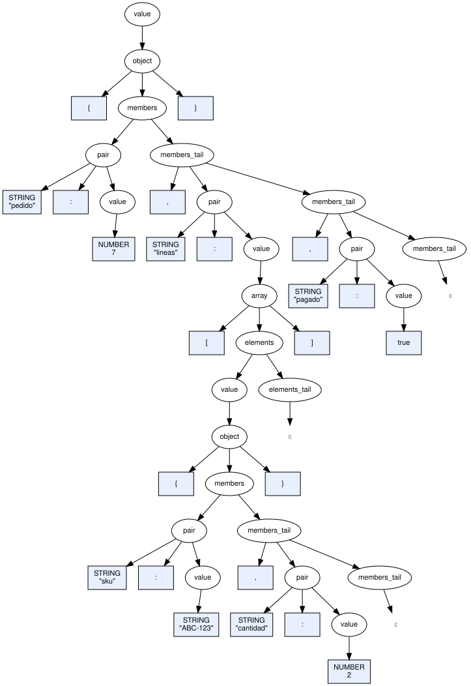
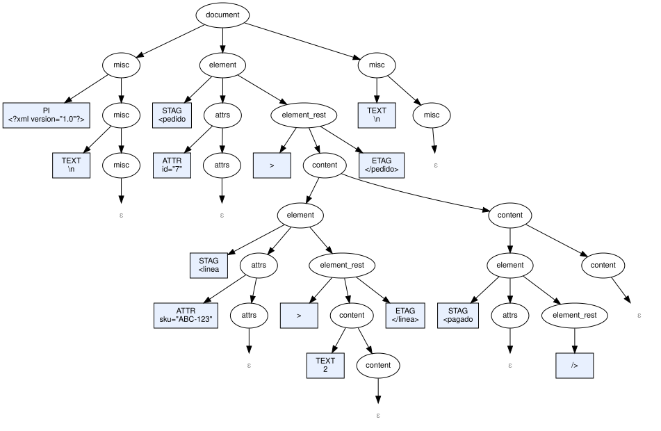

# Fase 2 — Análisis sintáctico

> Enunciado, §3: «Gramática libre de contexto de JSON y de XML bien formado, y del metalenguaje de esquemas; parser
> descendente LL(1) del esquema (el AST existe solo en tiempo de compilación); árboles de derivación de payloads de
> ejemplo.»

Código: `crates/schema-parser` (JSON Schema), `crates/xsd/src/{reader,parser,subset}.rs`,
`crates/dtd/src/parser.rs` y `crates/derivation` (árboles de derivación).
Gramáticas: los archivos `docs/fase2/*.ll1`. `scripts/ll1.py` los lee, calcula FIRST, FOLLOW y la tabla LL(1) y
escribe `docs/fase2/ll1-*.md`. Si una gramática tiene conflictos, el script termina con código 1.

## 1. Resumen de las gramáticas

| Gramática | Archivo | No terminales | Producciones | ¿LL(1)? | Tabla |
| --- | --- | ---: | ---: | --- | --- |
| JSON (RFC 8259) | `json.ll1` | 8 | 18 | sí | [ll1-json](../fase2/ll1-json.md) |
| JSON con recursión izquierda | `json-izquierda.ll1` | 6 | — | **no** (10 conflictos) | [ll1-json-izquierda](../fase2/ll1-json-izquierda.md) |
| XML bien formado | `xml.ll1` | 6 | 13 | sí | [ll1-xml](../fase2/ll1-xml.md) |
| Metalenguaje JSON Schema | `esquema.ll1` | 25 | 60 | sí | [ll1-esquema](../fase2/ll1-esquema.md) |
| Subconjunto XSD | `xsd.ll1` | 40 | 83 | sí | [ll1-xsd](../fase2/ll1-xsd.md) |
| Subconjunto DTD | `dtd.ll1` | 19 | 44 | sí | [ll1-dtd](../fase2/ll1-dtd.md) |

Al escribir este documento se volvió a correr `scripts/ll1.py` sobre las seis gramáticas: las tablas generadas
coinciden con las del repositorio, cinco terminan con código 0 (sin conflictos) y `json-izquierda` con código 1.

## 2. GLC de JSON

Los terminales son los tokens del lexer de la Fase 1: `{ } [ ] : , STRING NUMBER true false null`.

```
value         → object | array | STRING | NUMBER | true | false | null
object        → { members }
members       → pair members_tail | ε
members_tail  → , pair members_tail | ε
pair          → STRING : value
array         → [ elements ]
elements      → value elements_tail | ε
elements_tail → , value elements_tail | ε
```

**Por qué esta forma.** La gramática «natural» (`json-izquierda.ll1`)

```
object   → { } | { members }
members  → members , pair | pair
array    → [ ] | [ elements ]
elements → elements , value | value
```

no es LL(1). Tiene recursión izquierda (`members → members , pair`) y dos alternativas con el mismo prefijo
(`{ }` y `{ members }`). `ll1.py` informa 10 celdas con dos producciones, por ejemplo (`object`, `{`) y
(`elements`, `[`). La versión LL(1) sale de **factorizar por la izquierda** (`object → { members }` con
`members → … | ε`) y de **eliminar la recursión izquierda** con un no terminal de cola (`members_tail`).

**FIRST y FOLLOW** (generados):

| No terminal | FIRST | FOLLOW |
| --- | --- | --- |
| `value` | `NUMBER STRING [ false null true {` | `, ] } $` |
| `object` | `{` | `, ] } $` |
| `members` | `STRING ε` | `}` |
| `members_tail` | `, ε` | `}` |
| `pair` | `STRING` | `, }` |
| `array` | `[` | `, ] } $` |
| `elements` | `NUMBER STRING [ false null true { ε` | `]` |
| `elements_tail` | `, ε` | `]` |

**Tabla LL(1)** (celda vacía = error sintáctico):

| | `,` | `NUMBER` | `STRING` | `[` | `]` | `false` | `null` | `true` | `{` | `}` |
|---|---|---|---|---|---|---|---|---|---|---|
| `value` |  | NUMBER | STRING | array |  | false | null | true | object |  |
| `object` |  |  |  |  |  |  |  |  | { members } |  |
| `members` |  |  | pair members_tail |  |  |  |  |  |  | ε |
| `members_tail` | , pair members_tail |  |  |  |  |  |  |  |  | ε |
| `pair` |  |  | STRING : value |  |  |  |  |  |  |  |
| `array` |  |  |  | [ elements ] |  |  |  |  |  |  |
| `elements` |  | value elements_tail | value elements_tail | value elements_tail | ε | value elements_tail | value elements_tail | value elements_tail | value elements_tail |  |
| `elements_tail` | , value elements_tail |  |  |  | ε |  |  |  |  |  |

**El lenguaje no es regular.** Al intersecar L_JSON con el lenguaje regular `[* ]*` queda {`[`ᵏ `]`ᵏ : k ≥ 1}, que
no es regular (lema de bombeo para regulares). Como los regulares son cerrados bajo intersección, L_JSON tampoco lo
es: hace falta una pila. Esta es la familia que se bombea en la Fase 6.

**Restricción que la GLC no expresa: claves repetidas.** RFC 8259 deja el caso abierto, pero el proyecto lo
rechaza (un `{"a":1,"a":2}` es malformado). No es una propiedad libre de contexto. En el parser de esquemas se
comprueba con una tabla hash (`HashSet` con SipHash de semilla aleatoria, O(1) esperado por clave); en el
validador, con la máscara de bits de las claves declaradas y un hash de las demás (Fase 4).

## 3. GLC de XML bien formado

Terminales: los tokens del lexer XML agrupados. `STAG` es `StartTagOpen NameChar+`, `ATTR` es un atributo
completo, `>` y `/>` cierran la etiqueta de apertura, `ETAG` es `</nombre>`, `TEXT` es un tramo maximal de texto y
`PI` es una instrucción de procesamiento. Los comentarios ya los descartó el lexer.

```
document     → misc element misc
misc         → TEXT misc | PI misc | ε
element      → STAG attrs element_rest
element_rest → /> | > content ETAG
attrs        → ATTR attrs | ε
content      → TEXT content | PI content | element content | ε
```

| | `/>` | `>` | `ATTR` | `ETAG` | `PI` | `STAG` | `TEXT` | `$` |
|---|---|---|---|---|---|---|---|---|
| `document` |  |  |  |  | misc element misc | misc element misc | misc element misc |  |
| `misc` |  |  |  |  | PI misc | ε | TEXT misc | ε |
| `element` |  |  |  |  |  | STAG attrs element_rest |  |  |
| `element_rest` | /> | > content ETAG |  |  |  |  |  |  |
| `attrs` | ε | ε | ATTR attrs |  |  |  |  |  |
| `content` |  |  |  | ε | PI content | element content | TEXT content |  |

### 3.1 La igualdad de nombres no es libre de contexto

La gramática acepta `<a></b>`: no dice que el nombre de `ETAG` sea el de su `STAG`. Esa condición **no es libre de
contexto** sobre un alfabeto de nombres no acotado. Al intersecar el lenguaje de XML bien formado con el lenguaje
regular `<(a|b)+></(a|b)+>` queda

  L' = { `<`w`></`w`>` : w ∈ {a, b}⁺ },

que es, salvo los delimitadores fijos, el lenguaje {w # w}. Supongamos que L' es libre de contexto con constante de
bombeo p y tomemos z = `<`aᵖbᵖ`></`aᵖbᵖ`>`. Toda descomposición z = uvxyz' con |vxy| ≤ p y |vy| ≥ 1 cumple una de
estas cosas:

- toca un delimitador (`<`, `>`, `</`), y entonces bombear lo duplica o lo borra y la palabra sale de L';
- cae entera dentro de una de las dos copias de w, y entonces la otra copia no cambia;
- cruza el `></` central, y entonces bombea a lo sumo bᵖ por la izquierda y aᵖ por la derecha. uv²xy²z' tiene
  más b en la primera copia o más a en la segunda, así que las dos copias dejan de ser iguales.

En los tres casos uv²xy²z' ∉ L', una contradicción. Como los libres de contexto son cerrados bajo intersección con
regulares, XML bien formado no es libre de contexto.

**Por qué el proyecto sí puede validarlo con un DPDA.** El esquema (XSD o DTD) fija un conjunto **finito** de nombres
de elemento. Con un no terminal por nombre, `element_n → <n attrs > content_n </n>` es una GLC, y en el autómata
cada marco apilado recuerda qué elemento abrió (Fase 4). Los nombres que el esquema no declara se comparan por el
hash de su QName, guardado en el marco (capa de buena formación, Fase 4 §7).

## 4. Gramática del metalenguaje de esquemas (JSON Schema)

`esquema.ll1` describe el subconjunto de JSON Schema 2020-12 sobre los mismos terminales que JSON, más **clases de
palabra clave**. Una `K_*` no es un token nuevo del lexer. Es un `STRING` en posición de clave de un objeto-esquema,
clasificado por su valor con la tabla `KEYWORDS` de `schema-parser/src/ast.rs`, que tiene 42 entradas:

| Clase | Palabras clave | Valor que exige |
| --- | --- | --- |
| `K_STRING` | `$schema $id $anchor $ref $comment title description format pattern` | `STRING` |
| `K_NUMBER` | `minimum maximum exclusiveMinimum exclusiveMaximum multipleOf minLength maxLength minItems maxItems minProperties maxProperties` | `NUMBER` |
| `K_BOOL` | `uniqueItems deprecated readOnly writeOnly` | `true` o `false` |
| `K_SCHEMA` | `items additionalProperties not` | un esquema |
| `K_MAP` | `$defs definitions properties dependentSchemas` | objeto de esquemas |
| `K_LIST` | `prefixItems allOf anyOf oneOf` | arreglo de esquemas |
| `K_VALUE` | `const default` | cualquier valor JSON |
| `K_VALUES` | `enum examples` | arreglo de valores |
| `K_TYPE` | `type` | nombre o arreglo de nombres |
| `K_REQUIRED` | `required` | arreglo de cadenas |
| `K_DEPREQ` | `dependentRequired` | objeto de arreglos de cadenas |
| `K_OTHER` | cualquier otra cadena | cualquier valor (la Fase 3 la **rechaza**) |

```
schema        → { keywords } | true | false
keywords      → keyword keywords_tail | ε
keywords_tail → , keyword keywords_tail | ε
keyword       → K_STRING : STRING | K_NUMBER : NUMBER | K_BOOL : boolean | K_SCHEMA : schema
              | K_MAP : schema_map | K_LIST : [ schemas ] | K_VALUE : value | K_VALUES : array
              | K_TYPE : type_value | K_REQUIRED : string_array | K_DEPREQ : dep_map | K_OTHER : value
type_value    → STRING | string_array
string_array  → [ strings ]
schema_map    → { entries }
entries       → STRING : schema entries_tail | ε
schemas       → schema schemas_tail | ε
dep_map       → { deps }
…               (más las colas y el JSON genérico de §2 para value)
```

Las 25 producciones-cabeza y la tabla completa están en [ll1-esquema](../fase2/ll1-esquema.md). La gramática fija la
**forma** de cada valor (que `minimum` sea un número, que `required` sea un arreglo de cadenas). Lo que depende del
valor (que `minLength` sea ≥ 0, que `type` nombre un tipo que existe) es de la Fase 3.

### 4.1 El parser

`schema_parser::parse` es un **descendente recursivo escrito a mano**: una función por no terminal (`schema`,
`keyword`, `schema_map`, `schema_list`, `json`…) que decide la producción con **un** token de anticipación
(`self.look`), como dice la tabla. Las listas con cola se recorren con un bucle.

- **AST solo en compilación.** El resultado es un `Schema` (`ast.rs`) con cada palabra clave como `Keyword { name, kw,
  value, value_span }`. Los números se guardan como su **lexema** (`Num`), nunca como `f64`, para no perder
  precisión. El validador generado no construye ningún AST.
- **Errores con posición.** El primer error sintáctico se informa con línea y columna y una pista. Por ejemplo,
  `{"type":"objet","minimum":"3"}` da `línea 1, columna 27: se esperaba un número como valor de "minimum", se
  encontró la cadena "3"`.
- **Profundidad.** La recursión está acotada: `DEFAULT_MAX_DEPTH` = `MAX_DEPTH_LIMIT` = 256 niveles de `{`/`[`.
  Pasarlo es el error `TooDeep`, no un desbordamiento de pila. El tope se midió para hilos de ≥ 2 MiB de pila;
  `schemac` analiza el esquema en un hilo de 8 MiB (`STACK_SIZE`) y el servidor hace lo mismo.

## 5. Gramática y parser de XSD

**Lector** (`xsd::Reader`). Convierte los eventos del lexer XML en tokens bajo demanda. Comprueba lo que la GLC de §3
no expresa: el nombre de cierre igual al de apertura (con una **pila explícita** de elementos abiertos, sin
recursión), un único elemento raíz, atributos únicos (por nombre escrito y por nombre expandido), `<?xml …?>` solo
al principio y en UTF-8, y el ámbito de las declaraciones `xmlns`. Además resuelve cada QName a (URI, nombre
local), también los que aparecen como **valor** de un atributo (`type="xs:string"`).

**Gramática** (`xsd.ll1`, 40 no terminales). Los terminales son los del lector, con el `STAG` del espacio de nombres
de XML Schema refinado en una clase `S_*` por su nombre local: `S_SCHEMA S_ELEMENT S_COMPLEXTYPE S_SEQUENCE
S_CHOICE S_ALL S_ATTRIBUTE S_SIMPLECONTENT S_EXTENSION S_SIMPLETYPE S_RESTRICTION S_ANNOTATION S_DOCUMENTATION
S_APPINFO` y una por faceta (`S_ENUMERATION`, `S_MININCLUSIVE`, …, `S_PATTERN`). Un extracto:

```
document     → S_SCHEMA attrs schema_rest
top_item     → annotation | element | complex_type | simple_type | attribute
element      → S_ELEMENT attrs element_rest
element_rest → /> | > annot_opt element_type ETAG
complex_type → S_COMPLEXTYPE attrs ct_rest
ct_content   → simple_content | model_opt attr_decls
model_opt    → sequence | choice | all | ε
particle     → element | sequence | choice
restriction  → S_RESTRICTION attrs restr_rest
facet        → facet_tag attrs facet_rest
```

**Parser** (`xsd::parse`). Es descendente recursivo, con una función por construcción y un token de anticipación.
Aplica la **lista blanca de atributos** de cada construcción (`subset.rs`). Lo que es XSD válido pero queda fuera del
subconjunto (`xs:import`, `xs:any`, `substitutionGroup`, `nillable`…) es una celda vacía de la tabla con su propio
mensaje: categoría y motivo, nunca «error de sintaxis». La recursión sigue el anidamiento de elementos y el lector
la corta en 256 (`DEFAULT_MAX_DEPTH`).

## 6. Gramática y parser de DTD

```
dtd           → item dtd | ε
item          → PI | elementdecl | attlistdecl
elementdecl   → DECL_ELEMENT NAME contentspec GT
contentspec   → K_EMPTY | K_ANY | LPAR group_body
group_body    → K_PCDATA mixed | cp children_rest RPAR occ
children_rest → COMMA cp seq_rest | PIPE cp choice_rest | ε
cp            → NAME occ | LPAR cp children_rest RPAR occ
occ           → OPT | STAR | PLUS | ε
attlistdecl   → DECL_ATTLIST NAME attdefs GT
attdef        → NAME atttype defaultdecl
atttype       → T_CDATA | T_TOKENIZED | K_NOTATION LPAR NAME enum_rest | LPAR NAME enum_rest
defaultdecl   → K_REQUIRED | K_IMPLIED | K_FIXED LITERAL | LITERAL
…
```

Las palabras clave son **contextuales**: `EMPTY`, `ANY`, `CDATA`… solo son palabras clave en la posición que las
espera, y en otra posición son un `NAME` (`<!ELEMENT EMPTY EMPTY>` declara un elemento llamado `EMPTY`). La única
recursión, `cp → LPAR cp … RPAR occ`, se recorre con una **pila explícita** de grupos abiertos, con un tope de
256 paréntesis (`MAX_DEPTH`; pasarlo es un error `Limit`). `ANY`, el contenido mixto, `NOTATION`, los tipos
`ID/IDREF/ENTITY/NMTOKEN…`, los nombres con `:` y un `encoding` que no sea UTF-8 se reconocen y se rechazan como
`OutOfScope`, con su motivo.

## 7. Árboles de derivación

`crates/derivation` construye el árbol de derivación de un **payload** JSON o XML. Es un parser **predictivo LL(1)
con pila explícita**, sin recursión, sobre las gramáticas de §2 y §3, alimentado por el lexer de la Fase 1. Cada vez
que saca un no terminal de la pila elige la producción con el token de anticipación y crea el nodo, así que el
árbol queda en el orden de la **derivación más a la izquierda**, sin retroceso. Tiene un tope de 5 000 nodos
(`MAX_NODOS`) porque el árbol es para mostrar: el validador **no** construye árbol.

Salidas: `arbol <payload>` da JSON jerárquico para d3-hierarchy (la vista de la web, Fase 7) y `arbol --dot
<payload>` da DOT.

**Ejemplo a mano.** Para `{"pedido": 7, "pagado": true}`, cuyos tokens son `{ STRING : NUMBER , STRING : true }`,
la derivación más a la izquierda es:

```
value ⇒ object
      ⇒ { members }
      ⇒ { pair members_tail }
      ⇒ { STRING : value members_tail }
      ⇒ { STRING : NUMBER members_tail }
      ⇒ { STRING : NUMBER , pair members_tail }
      ⇒ { STRING : NUMBER , STRING : value members_tail }
      ⇒ { STRING : NUMBER , STRING : true members_tail }
      ⇒ { STRING : NUMBER , STRING : true }
```

**Ejemplos generados** con `arbol --dot` sobre `docs/fase5/ejemplos/pedido.json`
(`{"pedido": 7, "lineas": [{"sku": "ABC-123", "cantidad": 2}], "pagado": true}`) y `pedido.xml`
(`<?xml version="1.0"?><pedido id="7"><linea sku="ABC-123">2</linea><pagado/></pedido>`):





## 8. Costo

| Parser | Tiempo | Pila del hilo |
| --- | --- | --- |
| JSON Schema | O(n): un token por paso; claves repetidas con hash, O(1) esperado | O(profundidad) ≤ 256 marcos |
| Lector y parser XSD | O(n) más el hash de los nombres | O(profundidad) ≤ 256; el lector usa pilas en el montón |
| DTD | O(n) | O(1): pila explícita en el montón |
| Árbol de derivación | O(n) hasta `MAX_NODOS` | O(1): pila explícita |

La linealidad del parser de esquemas tiene un *benchmark* aparte: `crates/bench/benches/parser_claves.rs` mide con
N y 4N claves (Fase 6).
