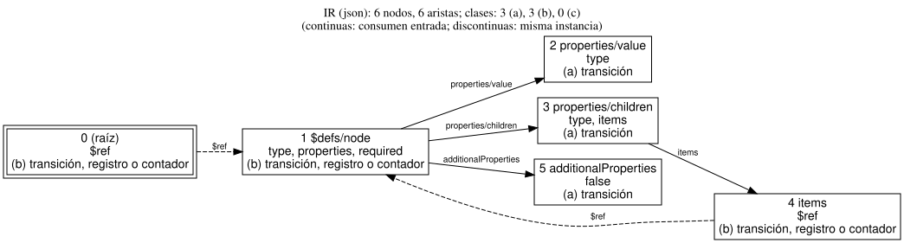
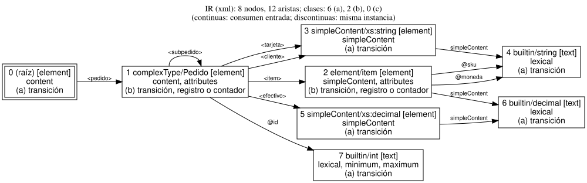
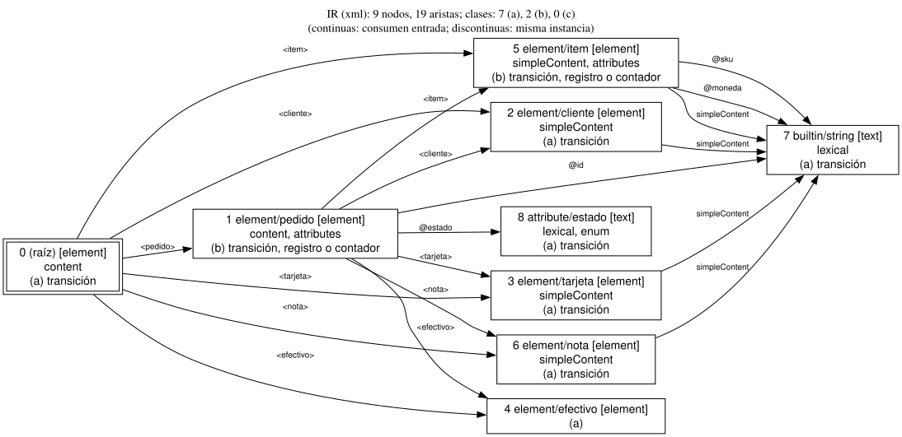

# Fase 3 — Análisis semántico del esquema

> Enunciado, §3: «Validación contra el meta-esquema, resolución de `$ref`/`$defs` con tabla de símbolos y detección
> de ciclos no productivos, y clasificación de palabras clave: (a) directas en el DPDA (`type`, `properties`,
> `items`, `enum`, `const`, límites); (b) con registros o contadores (`required` mediante máscara de bits,
> `minItems`/`maxItems`); (c) no deterministas o no libres de contexto (`anyOf`/`oneOf`/`allOf`, `pattern`,
> `uniqueItems`, dependencias), con estrategia de producto de autómatas, determinización acotada o verificación
> diferida.»

Código: `crates/semantic` (JSON Schema), `crates/ir` (representación intermedia, verificador, clasificación,
números y expresiones regulares), `crates/xsd/src/{check,symbols,simple,upa,lower}.rs` y
`crates/dtd/src/{check,lower}.rs`.

## 1. Tubería

```
 JSON Schema ─ parse ─▶ AST ─▶ meta-esquema ─▶ tabla de símbolos ($ref) ─▶ ciclos ─▶ bajada ─┐
 XSD ──────── parse ─▶ AST ─▶ nombres y componentes ─▶ tipos simples ─▶ modelos (UPA) ─▶ bajada ─┼─▶ Ir::verify ─▶ VerifiedIr ─▶ Fase 4
 DTD ──────── parse ─▶ AST ─▶ símbolos, valores, determinismo (Glushkov) ─────────▶ bajada ─┘
```

- **Por etapas.** `semantic::analyze` encadena `check_meta_schema` → `SymbolTable::build` → `check_cycles`, y
  devuelve **todos** los errores de la primera etapa que falla, ordenados por posición. Una etapa necesita la
  anterior completa: con un `$ref` remoto ya rechazado no tiene sentido informarlo otra vez como «no resuelto».
- **Sin recursión.** Todo recorrido del AST usa una pila explícita en el montón, así que el consumo de pila del hilo
  no depende de la profundidad del esquema.
- **Detección del formato.** `dtd::formato` decide por el **contenido**, no por la extensión. Tras un BOM,
  espacios, `<?xml …?>` y comentarios, un `<!` (que no sea `<!DOCTYPE`) es DTD, otro `<` es XSD y cualquier otra
  cosa es JSON Schema. La usan `schemac` y el servidor.

## 2. Validación contra el meta-esquema (JSON Schema)

El parser ya fijó la forma de cada valor. `semantic::meta` comprueba lo que depende del valor, con la regla del
meta-esquema 2020-12 de la que sale cada comprobación:

| Comprobación | Error |
| --- | --- |
| `$schema` solo puede ser `https://json-schema.org/draft/2020-12/schema` (se admite con `#` final) | `unsupported` |
| `$id` solo en la raíz y sin fragmento no vacío (`^[^#]*#?$`) | `unsupported` / `meta-schema` |
| `$ref` local: `""` o `#…` (no se resuelven URI remotas) | `unsupported` |
| `$anchor` con la forma `^[A-Za-z_][-A-Za-z0-9._]*$` | `meta-schema` |
| `type`: nombres de `null boolean object array number integer string`, sin repetir | `meta-schema` |
| `multipleOf` > 0 | `meta-schema` |
| `minLength`, `maxLength`, `minItems`, `maxItems`, `minProperties`, `maxProperties`: enteros ≥ 0 | `meta-schema` |
| `required` y cada lista de `dependentRequired` sin cadenas repetidas | `meta-schema` |
| `prefixItems`, `allOf`, `anyOf`, `oneOf` no vacíos | `meta-schema` |
| `pattern` dentro del subconjunto regular (§7) | `unsupported` / `limit` |
| palabra clave fuera del subconjunto | `unsupported`, con **categoría y motivo** |

«Entero» se decide sobre el **lexema**, sin pasar a binario (`semantic::number`). El valor es D × 10^s, con D los
dígitos sin ceros a la derecha, y es entero si y solo si s ≥ 0. Así `1.0`, `1e2` y `1.5e1` son enteros, igual que
en 2020-12.

**Las palabras clave fuera del subconjunto nunca se ignoran.** El parser las deja pasar como `K_OTHER` y
`semantic::unsupported` las rechaza con su categoría:

| Palabras clave | Categoría | Motivo resumido |
| --- | --- | --- |
| `if`, `then`, `else` | (c) | aplicación condicional: hay que evaluar los tres subesquemas a la vez |
| `contains` | (c) | existencial sobre los elementos |
| `minContains`, `maxContains` | (b) | contadores de `contains` |
| `patternProperties`, `propertyNames` | (c) | producto de AFD sobre las claves; candidatos a añadirse |
| `unevaluatedProperties`, `unevaluatedItems` | (c) | dependen de lo que evaluaron las demás palabras clave |
| `$dynamicRef`, `$dynamicAnchor`, `$vocabulary` | núcleo | resolución dinámica o meta-esquema propio |
| `contentEncoding`, `contentMediaType`, `contentSchema` | anotación | el validador no decodifica ese contenido |
| `additionalItems`, `dependencies`, `$recursiveRef`, `$recursiveAnchor` | borradores anteriores | sustituidas en 2020-12 |
| cualquier otra | desconocida | con sugerencia si está a distancia de edición ≤ 2 de una soportada |

Ejemplo real de `schemac check` con `{"type":"objet","if":true}`:

```
línea 1, columna 9: valor inválido para "type" según el meta-esquema: se esperaba un nombre de tipo (null, boolean,
object, array, number, integer o string), se encontró "objet"
línea 1, columna 17: palabra clave "if" no soportada (clase (c), no determinista o no libre de contexto): aplicación
condicional: el resultado de `if` decide si el valor debe cumplir `then` o `else`, así que hay que evaluar los tres
subesquemas a la vez (producto de autómatas)
```

## 3. Tabla de símbolos y resolución de `$ref`

`semantic::SymbolTable` asigna a cada subesquema un `SchemaId`: su número en **preorden en orden de documento**. Es
estable porque solo depende del texto, no de semillas de hash. Por cada subesquema registra:

- su **padre** y el **paso** desde él (`properties/a`, `items`, `allOf/2`…), de donde se reconstruye su puntero
  JSON. No se guarda la ruta entera, porque eso sumaría las longitudes de todas las rutas (cuadrático en el peor
  caso);
- las anclas (`$anchor`), sin repetir (`DuplicateAnchor`);
- las entradas de `$defs` y `definitions`;
- el destino de cada `$ref`.

**Resolución** (`semantic::pointer`). El fragmento de un `$ref` se decodifica en dos niveles (RFC 6901 §6): primero
los `%XX` de RFC 3986, con resultado UTF-8 válido, y después el puntero, con segmentos separados por `/` donde `~1`
es `/` y `~0` es `~`. Si el fragmento empieza por `/` es un puntero JSON, si está vacío es la raíz y en otro caso es
un `$anchor`. El puntero se recorre sobre el documento con un índice hash **sin seguir otros `$ref`**, así que una
referencia circular (`A → B → A`, un árbol recursivo) se resuelve como cualquier otra y no hay bucle. Los problemas
posibles: no local, `%` mal formado, `~` inválido, ancla desconocida, segmento inexistente, un puntero que entra en
un literal (`const`, `enum`) o que apunta a algo que no es un esquema.

## 4. Ciclos no productivos

Sobre la tabla se construye el grafo **G₀** de las aristas que **no consumen entrada**:

- `$ref`;
- los aplicadores sobre la **misma** instancia: `allOf`, `anyOf`, `oneOf`, `not` y `dependentSchemas`.

`properties`, `additionalProperties`, `items` y `prefixItems` **no** entran en G₀: aplican su subesquema a una
instancia hija, que empieza después de al menos un token del padre (`{` y la clave, o `[`).

**Definición.** Un ciclo de G₀ es **no productivo**: validar un valor con un esquema del ciclo exige volver a
validarlo, el mismo valor y con el mismo esquema, sin haber leído ningún token. En el autómata sería un bucle de
transiciones ε sobre la misma posición de la entrada, que no puede ser determinista ni terminar. Se rechaza.

**Algoritmo.** Componentes fuertemente conexas de Tarjan, en versión **iterativa** (pila explícita), O(V + E). Cada
componente con ciclo da un error, en el `$ref` del ciclo que aparece primero en el texto, con un camino concreto:

```
línea 1, columna 23: ciclo de referencias que no consume entrada (validar el valor exigiría volver a validarlo con
el mismo esquema sin leer ningún token): #/$defs/a —$ref→ #/$defs/b —allOf→ #/$defs/b/allOf/0 —$ref→ #/$defs/a
```

Un árbol recursivo, en cambio, sí es productivo: en `{"$defs":{"node":{"properties":{"children":{"items":
{"$ref":"#/$defs/node"}}}}}}` el `$ref` está detrás de `properties` e `items`, que consumen `{`, una clave y `[`.
Ese esquema compila y se usa en el corpus (`valid-recursive-tree-01`).

## 5. La representación intermedia (IR)

`crates/ir` es el contrato entre los tres frontales y la Fase 4. No depende de ningún frontal.

**Grafo en arena.** `Ir::nodes: Vec<Node>`, con las aristas como `NodeId`. Un subesquema referenciado muchas veces
está una sola vez, así que la IR es O(n) en el número de subesquemas. Ningún tipo es recursivo (no hay
`Box<Node>`): los literales de `enum` son una lista de tokens en preorden y los modelos de contenido una arena de
partículas, de modo que ni el verificador ni la liberación de memoria recursan.

```rust
pub struct Node { pub sort: Sort, pub rules: Vec<Constraint>, pub origin: Origin }
pub enum Sort { Json, Element, Text }   // un valor JSON, un elemento XML, un texto XML
```

**Reglas** (`ir::Rule`, 31 clases, `RuleKind::ALL`): `Reject` (el esquema `false`), `Ref`, `Type`, `Enum`, `Const`,
`Minimum`, `Maximum`, `ExclusiveMinimum`, `ExclusiveMaximum`, `MultipleOf`, `MinLength`, `MaxLength`, `Pattern`,
`Items { prefix, rest }`, `MinItems`, `MaxItems`, `UniqueItems`, `Properties { declared, additional }`, `Required`,
`MinProperties`, `MaxProperties`, `DependentRequired`, `DependentSchemas`, `AllOf`, `AnyOf`, `OneOf`, `Not` y las
de XML: `Attributes`, `Content` (modelo de solo elementos), `SimpleContent` y `Lexical` (espacio léxico de un tipo
predefinido). Cada regla lleva el `Span` de su palabra clave para los mensajes del validador.

**Invariantes** (`Ir::verify` → `VerifiedIr`). Las fases siguientes solo aceptan una `VerifiedIr`, que cumple:

| | Invariante |
| --- | --- |
| I1 | el origen de los nodos forma un árbol con raíz en 0 (el padre siempre es anterior) |
| I2 | toda arista apunta a un nodo que existe |
| I3 | cada regla admite el tipo (`Sort`) de su nodo |
| I4 | como mucho una regla de cada clase por nodo; contenido simple **o** de elementos |
| I5 | el destino de cada arista es del tipo que exige la regla |
| I6 | los tipos de nodo corresponden al formato (en XML la raíz es el documento) |
| I7 | ninguna lista vacía donde la regla exige al menos un elemento |
| I8 | números como lexemas RFC 8259; `multipleOf` > 0 |
| I9 | literales de `enum`/`const` bien formados, con las claves ordenadas |
| I10 | nombres únicos donde la regla lo exige |
| I11 | el modelo de contenido es un árbol en preorden; ocurrencias coherentes |
| I12 | `xs:all` dentro de las restricciones de XSD 1.0; *Element Declarations Consistent* |
| I13 | textos con espacio léxico único y facetas aplicables; atributos sin `default` y `fixed` a la vez |
| I14 | el subgrafo de aristas sobre la misma instancia (`$ref`, `allOf`…) es **acíclico** |

Si la IR que sale de un frontal no los cumple, es un error interno del compilador (código 3 de `schemac`), nunca un
error del esquema del usuario.

**Exportación.** `schemac ir` escribe un JSON estable (`irVersion: 2`) con cada nodo, sus reglas y su clase.
`schemac ir --dot` escribe el grafo. Ejemplo para `{"type":"object","properties":{"a":{"type":"integer"}},
"required":["a"],"additionalProperties":false}`:

```json
{ "irVersion": 2, "format": "json", "nodeCount": 3, "edgeCount": 2, "classCount": {"a": 2, "b": 1, "c": 0},
  "nodes": [
    { "id": 0, "class": "b", "strategies": ["transition", "register"], "rules": [
        {"rule": "type", "class": "a", "strategy": "transition", "types": ["object"]},
        {"rule": "properties", "class": "a", "strategy": "transition",
         "declared": [{"name": "a", "target": 1}], "additional": 2},
        {"rule": "required", "class": "b", "strategy": "register", "names": ["a"]} ] },
    { "id": 1, "step": {"keyword": "properties", "entry": "a"}, "class": "a",
      "rules": [ {"rule": "type", "types": ["integer"], "class": "a"} ] },
    { "id": 2, "step": {"keyword": "additionalProperties"}, "class": "a",
      "rules": [ {"rule": "false", "class": "a"} ] } ] }
```

(Se omitieron los `span`.) IR de un árbol recursivo, donde el `$ref` es una arista hacia un nodo anterior y no una
copia:



## 6. Clasificación (a)/(b)/(c)

La clase no se guarda en la IR: sale de una sola tabla, `RuleKind::classification` (`crates/ir/src/classify.rs`).

| Clase | Estrategia | Reglas |
| --- | --- | --- |
| **(a)** directas en el DPDA | `transition` | `false`, `$ref`, `type`, `enum`, `const`, `minimum`, `maximum`, `exclusiveMinimum`, `exclusiveMaximum`, `multipleOf`, `items`/`prefixItems`, `properties`/`additionalProperties`, `simpleContent`, espacio léxico, modelo de contenido sin contadores |
| **(b)** con registros o contadores | `register` | `required` (máscara de bits), `minItems`, `maxItems`, `minProperties`, `maxProperties`, `minLength`, `maxLength`, atributos XML (máscara); modelo de contenido con `xs:all` o con `minOccurs` ≥ 2 o `maxOccurs` acotado > 1 |
| **(c)** no deterministas o no libres de contexto | `dfa` | `pattern` → AFD minimizado (Fase 4) |
| | `product` | `allOf`, `not` |
| | `bounded-determinization` | `anyOf`, `oneOf` |
| | `deferred` | `uniqueItems` (hash canónico al cerrar el arreglo), `dependentSchemas` |
| | `register` | `dependentRequired` (máscara al cerrar el objeto) |

**Clase de un nodo** (`ir::classify`): la **máxima** entre sus reglas y las de los nodos que aplica a la misma
instancia (las aristas de E₌), y la unión de sus estrategias. Se calcula en postorden sobre E₌, que es acíclico
por I14, con una pila explícita y en O(n + m) sin expandir caminos.

**Por qué cada clase.**

- (a) La decisión depende solo del evento actual y del estado: `type` mira qué token abre el valor, `properties`
  elige el subautómata por la clave (un trie), `enum` y `const` de escalares son un trie de literales, y los rangos
  se comparan sobre el lexema al cerrar el número.
- (b) Hace falta memoria acotada por el esquema dentro del marco: un bit por clave requerida o un contador. El
  conjunto de valores de los registros es finito (los contadores saturan), así que el autómata sigue siendo un
  autómata de pila. Los registros solo amplían el alfabeto de la pila.
- (c) `pattern` es regular, pero hay que determinizar su autómata de posiciones, con riesgo de explosión. Las
  conjunciones (`allOf`) piden el producto de autómatas. Las disyunciones (`anyOf`, `oneOf`) piden correr las
  ramas en paralelo y decidir al final. `uniqueItems` compara elementos entre sí, lo que no es libre de contexto.
  La Fase 4 explica cómo se resuelve cada uno y con qué tope.

## 7. Expresiones regulares de `pattern` (mitigación de ReDoS)

`ir::regex::parse` analiza el patrón (ECMA-262 con semántica `u` en JSON Schema; XSD Parte 2, apéndice F, en
`xs:pattern`) a un AST en arena, sin recursión, y **rechaza lo que no es regular** o no está en el subconjunto. Por
ejemplo, `^(a)\1$` da `forma de "pattern" fuera del subconjunto (`\1` …): retrorreferencias: no son regulares`, y
`(?=a)b` da `lookahead: no es regular en un recorrido de una pasada`. También rechaza los cuantificadores perezosos
y las anclas en medio del patrón.

**Topes.** Hay un máximo de 4 096 posiciones tras expandir `{m,n}` (`MAX_POSITIONS`), contadas con multiplicación
saturada **antes** de expandir, y de 256 grupos anidados (`MAX_NESTING`). `Regex::glushkov` da el autómata de
posiciones de cada alternativa, que la Fase 4 determiniza. Un patrón clásico de ReDoS como `^(a+)+b$` **se
acepta** y compila a un AFD de 4 estados: como el validador nunca retrocede, no hay ReDoS posible.

## 8. Frontal XSD

1. **Nombres y componentes** (`check.rs`, etapa 1). Tabla de símbolos por clase de componente (elementos, tipos y
   atributos), indexada por **(identidad del URI, nombre local)**, nunca por el texto del URI, con el *hasher*
   aleatorio de `std`. Comprueba NCName, combinaciones de atributos (`name`/`ref`, `type`/tipo anónimo,
   `default`/`fixed`, `use="required"` con `default`), nombres repetidos, referencias sin resolver y tipos fuera del
   subconjunto.
2. **Tipos simples** (`simple.rs`, etapa 2). Derivación circular detectada con una marca de tres colores y pila
   explícita. En orden topológico: el primitivo heredado, las facetas aplicables y sin repetir, la *facet valid
   restriction* frente a la base y las enumeraciones como valores de la base. Un tipo con error queda «envenenado»
   y sus derivados no repiten el error. Tipos predefinidos: `string boolean decimal integer long int short byte
   nonNegativeInteger positiveInteger double float` (más `anySimpleType` interno).
3. **Modelos de contenido** (`upa.rs`, etapa 3). `minOccurs` ≤ `maxOccurs`, *all-group limited*, *Element
   Declarations Consistent* y **Unique Particle Attribution**:
   - **Abstracción conservadora.** Cada partícula se lee como una expresión regular sobre los nombres locales:
     `maxOccurs` > 1 es `+` (o `*`) y `minOccurs="0"` es `?`. Así solo crecen *first* y *follow*: si la
     abstracción es determinista, el modelo exacto también. Se rechazan de más casos como `a{2,2}, a`, que XSD 1.0
     admite.
   - **Determinismo fuerte.** Con un contador por partícula, también se exige que cada transición actualice los
     contadores de **una sola** manera. Por eso se rechaza `(a{1,2}){2,2}`.
   - **Tope.** Como mucho 4 096 partículas por modelo, comprobadas antes de calcular nada. El costo es
     O(n·m) ≤ 3·n·(m + 1) por modelo.
4. **Números XSD** (`ir::num`). Forma léxica de `xs:integer`, `xs:decimal`, `xs:float`/`xs:double` y `xs:boolean`;
   reescritura a un lexema de RFC 8259 del mismo valor (`+1.50` → `1.5`); **comparación exacta** de lexemas con
   exponentes de cualquier longitud; y redondeo IEEE al par más cercano para `xs:float`/`xs:double`.
5. **Bajada** (`lower.rs`). El nodo 0 es el documento (un elemento sin atributos cuyo contenido es la elección de
   los elementos globales); después vienen las declaraciones en preorden y los nodos sintéticos (predefinidos,
   envoltorios de `simpleContent`). Cada uso de un tipo es una **arista**, nunca una copia, así que la bajada es
   O(n).



## 9. Frontal DTD

`dtd::analyze` construye la tabla de símbolos de `<!ELEMENT>` y `<!ATTLIST>` y comprueba los valores por defecto,
los `#FIXED` y las enumeraciones. También comprueba el **determinismo** de cada modelo de contenido, como pide XML
1.0 (apéndice E): el modelo se aplana a una arena en preorden y se calcula su Glushkov recorriéndola de atrás
hacia adelante, sin recursión. Tope: 4 096 partículas por modelo (`MAX_PARTICLES`). La bajada produce la misma
forma de IR que XSD, sin campos nuevos: un nodo `Element` por `<!ELEMENT>`, el predefinido `builtin/string` para
`#PCDATA` y `CDATA`, y un nodo `Text` por atributo enumerado. Como no hay `<!DOCTYPE>` que la nombre, la raíz del
documento puede ser **cualquier** elemento declarado.



## 10. Costo

| Etapa | Tiempo |
| --- | --- |
| Meta-esquema | O(n) |
| Tabla de símbolos y `$ref` | O(n + longitud de los punteros), con hash |
| Ciclos (Tarjan) | O(V + E) |
| Bajada JSON Schema | O(n), salvo ordenar las claves de los literales: O(k log k) por objeto |
| Verificación de la IR | O(n + m log m), con m errores (m = 0 en una IR válida) |
| Clasificación | O(n + m) en nodos y aristas de E₌ |
| UPA de XSD | O(n·m) por modelo, con n ≤ 4 096 |
