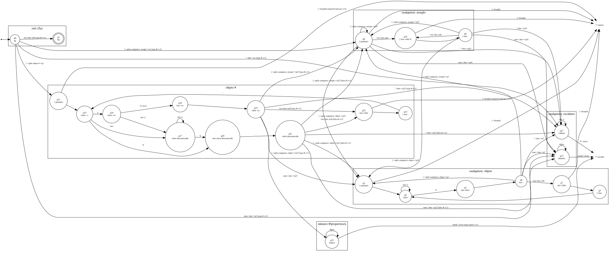
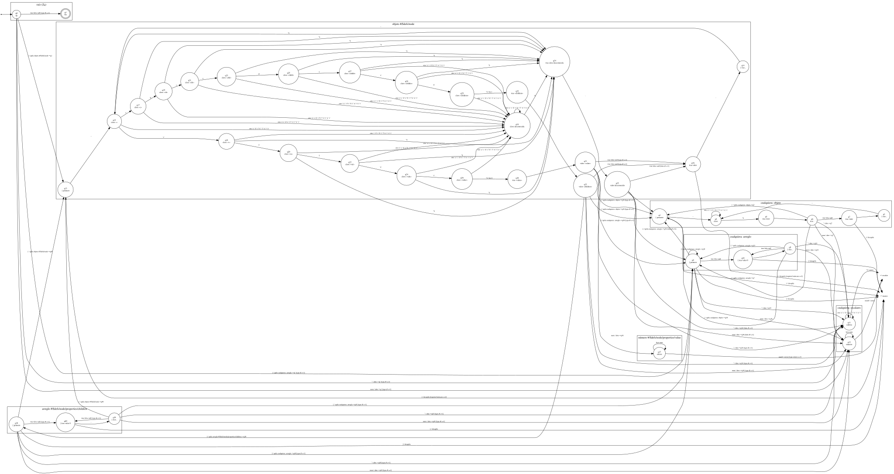

# Fase 4 — Construcción del autómata de pila ponderado

> Enunciado, §3: «Definición formal M = (Q, Σ, Γ, δ, q₀, Z₀, F, w) con pesos en el semianillo tropical: el peso
> estima el costo de cada transición para ordenar comprobaciones (fallo temprano) y acumula el número de
> violaciones para reportar la conformidad del payload; construcción composicional por nodo del esquema,
> verificación de determinismo de δ y minimización de estados.»

Código: `crates/automaton` (constructor: `json.rs`, `xml.rs`, `conj.rs`, `glushkov.rs`, `pattern.rs`, `text.rs`,
`dfa.rs`, `minimize.rs`, `determinism.rs`, `weight.rs`, `export.rs`) y `crates/runtime-rs` (formato de las tablas
y núcleo `no_std` que las ejecuta: `tables.rs`, `core.rs`, `weight.rs`, `num.rs`, `hash.rs`, `limits.rs`).

## 1. Definición formal

Para cada esquema S (ya como `VerifiedIr`), `automaton::build` construye

  M_S = (Q, Σ, Γ, δ, q₀, Z₀, F, w)

**directamente como tablas densas** (`automaton::Automaton`):

| Componente | En el código |
| --- | --- |
| **Q** | `0 .. n_states` (`StateId`). Cada estado pertenece a un **grupo** (el subautómata de un nodo, o «cualquiera»), que es su clúster en el DOT. |
| **Σ** | `0 .. n_classes` (`ClassId`): las **clases de eventos** del lexer. En JSON, 14 clases fijas (`{ } [ ] : , true false null " "$ num byte-num num$`) más, desde la 14 (`CHAR`), las clases de punto de código que el esquema distingue. En XML, `< </ @ =" "$ > /> </…> <? ?> <?…` más las de carácter. |
| **Γ** | los **tipos de marco** (`Frame`): cada símbolo de pila es (tipo de marco, estado de retorno, registros). Los registros son la máscara de bits de nombres, k contadores y las salidas de los combinadores. |
| **δ** | `delta[q · │Σ│ + a] → TransId`: una **función total**. La transición 0 (`ERROR`) es el error de sintaxis, al que va toda entrada que la gramática no admite. |
| **q₀** | `start` |
| **Z₀** | la pila vacía: el marco raíz no se apila |
| **F** | {`accept`} con la pila vacía |
| **w** | el peso de cada transición: el número de comprobaciones que fallan, en el semianillo tropical |

Cada transición (`runtime_rs::tables::Trans`) es

  δ(q, a, X) = (q', op, bit, contadores, comprobaciones, salidas)

con `op` ∈ {`Move`, `Push(marco, retorno)`, `Pop`, `Enter(retorno)`, `Leave`, `Fail(causa)`}.

- `Push` apila un marco, en `{` o `[` en JSON y en `>` de una etiqueta de apertura en XML.
- `Pop` desapila y vuelve al estado de retorno guardado en el marco.
- `Enter` y `Leave` abren y cierran un escalar (cadena o número). El escalar **no se apila**: como mucho hay uno
  abierto, y su retorno va en un registro global.
- `Fail` es una transición de peso ∞ (`Syntax`, `Duplicate`, `Limit`, `Internal`).

**¿Por qué sigue siendo un autómata de pila?** Los registros de un marco tienen tamaño fijo por esquema y los
contadores **saturan**, así que el conjunto de valores posibles de un marco es finito. Γ es finito, y la única
memoria no acotada es la pila, como en un PDA estricto.

## 2. El alfabeto Σ y la composición con el lexer

M no lee bytes: lee los **eventos** que emite el lexer de la Fase 1. El lexer es un transductor finito
determinista T : Σ_b* → Σ*, y el validador es la composición **M ∘ T** en una sola pasada (`runtime_rs::json` y
`runtime_rs::xml`): cada byte entra una vez al lexer y cada evento una vez a δ. Cada byte produce un número
**acotado** de eventos (en JSON, como mucho dos: el fin de un número y el token siguiente), así que M ∘ T es un DPDA
sobre bytes cuyas transiciones hacen un número acotado de operaciones de pila.

Los caracteres de una cadena (o de un nombre o un texto XML) son eventos `CHAR + clase`. La partición de los puntos
de código en clases depende del esquema: si `properties` declara `"a"` y `"b"`, hacen falta clases para `a`, para
`b` y para «cualquier otro carácter». `determinism::check` comprueba que esas clases son una **partición** de
[0, 0x10FFFF] sin los sustitutos (128 entradas ASCII más rangos ordenados y disjuntos).

## 3. Pesos: el semianillo tropical

`runtime_rs::Weight` implementa (ℕ ∪ {∞}, ⊕ = mín, ⊗ = +, 0̄ = ∞, 1̄ = 0) sobre un `u64`: `u64::MAX` es ∞ y los
finitos **saturan** en `Weight::MAX_FINITE`. Saturar es un homomorfismo ℕ ∪ {∞} → [0, M] ∪ {∞}, así que conserva
las leyes del semianillo y nunca confunde «muchas violaciones» con un payload malformado.

Como M es determinista, cada entrada w tiene **un** recorrido, y su peso es el producto ⊗ (la suma) de los pesos
de sus transiciones. ⊕ (el mínimo) solo aparecería entre recorridos alternativos, que un DPDA no tiene:

| W(w) | Significado |
| --- | --- |
| 0 | w es válido: w ∈ L(S) |
| ∞ | w está mal formado (léxico o sintaxis), tiene una clave repetida o pasa un límite |
| k ≥ 1 | w está bien formado y viola k comprobaciones del esquema (en modo de conformidad total) |

**Dos pesos sobre las mismas transiciones.** Además de w, cada comprobación lleva un **costo estático** c
(`automaton::weight::cost`), que sirve para **ordenar** las comprobaciones de una transición de la más barata a la
más cara. En **modo de fallo temprano** (`Mode::EarlyFail`), el ejecutor se detiene en la primera transición de peso
> 0 e informa de la comprobación de menor costo. En **conformidad total** (`Mode::Total`) sigue hasta el final y
cuenta todas las violaciones.

| c | Reglas |
| ---: | --- |
| 1 | `type`, `false`, espacio léxico, `$ref`, `items`, `properties`, atributos, contenido, `simpleContent` |
| 2 | `required`, `min/maxProperties`, `min/maxItems`, `min/maxLength` |
| 3 | `dependentRequired` |
| 4 | `minimum`, `maximum`, `exclusiveMinimum`, `exclusiveMaximum` |
| 5 | `const` |
| 6 | `enum` |
| 8 | `multipleOf` |
| 10 | `pattern` |
| 12 | `uniqueItems` |
| 16 | `allOf`, `anyOf`, `oneOf`, `not`, `dependentSchemas` |

## 4. Construcción composicional por nodo

`automaton::build` recorre la IR con una **lista de trabajo**, sin recursión, en cuatro etapas:

1. **Lo no compilable se rechaza antes de construir nada**, recorriendo todo lo alcanzable desde la raíz.
2. **Conjunto canónico de cada instancia** (`conj.rs`). Un valor no lo lee «un nodo», sino el **cierre conjuntivo**
   C(v): los nodos que aportan reglas propias entre v y los alcanzables por `$ref` y `allOf`, que se aplican a la
   misma instancia. Es un **conjunto**, no una lista de caminos: una cadena de diamantes `$ref` con 2^(10⁴) caminos da
   un solo nodo. Cada conjunto se guarda una vez y su id es el **tipo de marco** que lo lee. Un conjunto de un nodo
   es un subautómata simple; uno de varios es un **producto** de sus componentes.
3. **Análisis de cada conjunto alcanzable.** Se calculan sus subautómatas de objeto, arreglo, número y cadena, sus
   hijos y su **tamaño exacto**. Los topes (estados por producto, presupuesto de δ) se comprueban aquí, **antes de
   reservar** memoria.
4. **Reserva y relleno.** Primero se reservan los estados de cada subautómata y después se rellenan sus filas.
   Así, cuando un padre apila a un hijo, los estados del hijo ya existen, también si hay recursión (un `$ref` a un
   antepasado).

### 4.1 Piezas de un subautómata JSON

| Construcción | Cómo se compila |
| --- | --- |
| marco «cualquiera» | la gramática JSON de la Fase 2 como DPDA: objeto, arreglo y escalares, sin comprobaciones. Lo usan los valores sin esquema (`true`, `{}`) |
| `type` | qué evento abre el valor: un tipo no admitido es una comprobación `Fails` de peso 1 en la transición de entrada |
| `properties` / `additionalProperties` | **trie de claves** sobre las clases de carácter: al cerrar la clave (`"$`), el estado dice qué subesquema apilar. Las claves no declaradas van a `additionalProperties` (o a `false`) |
| `required`, `dependentRequired` | **máscara de bits** en el marco del objeto: la transición que cierra la clave declarada fija su bit (`Trans::bit`), y en `}` se comprueba `Mask` / `Dependent` |
| clave declarada repetida | si al fijar el bit ya estaba, es `Fail(Duplicate)`: el payload está mal formado (peso ∞) |
| `min/maxProperties`, `min/maxItems` | un **contador** en el marco (`CounterOp::Add`, saturado) comprobado al cerrar (`CountMin`, `CountMax`) |
| `prefixItems`, `items` | estados por posición del arreglo: la posición i apila el subesquema i y después el de `items` |
| `minimum`, `maximum`, exclusivos, `multipleOf` | al cerrar el número (`num$`), sobre su **lexema** (≤ 1 024 bytes) con aritmética decimal exacta, sin `f64` (`runtime_rs::num`) |
| `integer` | comprobación `Integer` sobre el lexema |
| `enum`/`const` de cadenas | trie de literales en los estados de la cadena |
| `enum`/`const` de números | `NumEnum`: igualdad por valor contra una lista ordenada |
| `minLength`, `maxLength` | contador global de puntos de código de la cadena abierta |
| `pattern` | un **AFD minimizado** dentro de los estados de la cadena (§5) |

### 4.2 Ejemplo completo: objeto cerrado

Esquema `{"type":"object","properties":{"a":{"type":"integer"}},"required":["a"],"additionalProperties":false}`.
`schemac automaton --dot` da 24 estados, 77 transiciones, 3 tipos de marco y 16 clases:

Cómo se lee (de `docs/fase4/automata-objeto-cerrado.dot`):

- **q0 → q13** con `{ / apila objeto # ↩q1`: el objeto raíz apila el marco del nodo `#` con retorno a q1 (`fin`,
  el de aceptación). Cualquier otro comienzo (`[`, `true`, un número…) sigue al marco «cualquiera», pero con
  `[type ✗ c=1]`: suma 1 al peso.
- **q13/q14 → q15**: empieza una clave. El **trie** distingue `'a'` (q17) de «otro» (q16). En q17, `"$ / bit 0`
  cierra la clave `a` y fija el bit 0 de la máscara.
- **q19**: el valor de `a`. Un `num` abre el escalar en q23 (`número #/properties/a`), donde `num$ / cierra [type
  entero c=1]` comprueba que sea entero al cerrar. Cualquier otro valor lleva `[type ✗ c=1]`.
- **q20 → q21**: el valor de una clave desconocida. Todas sus transiciones llevan `[false ✗ c=1]`, porque
  `additionalProperties: false` es el esquema `false` aplicado a ese valor.
- **q13/q22 → desapila** con `} / desapila [required máscara c=2]`: al cerrar el objeto se comprueba que el bit 0
  esté puesto.
- Los grupos «cualquiera» (q2–q12) leen los valores sin esquema sin comprobar nada.

Así, `{"a": 1}` pesa 0, `{"a": "x"}` pesa 1 (el tipo de `a`), `{"b": 1}` pesa 2 (la clave extra y el `required`) y
`{"a": 1, "a": 2}` pesa ∞ (clave repetida: el reporte la da como error `syntax`). Las cuatro cifras se
comprobaron con el validador generado para este esquema.

### 4.3 Recursión: árbol recursivo

Con `"$defs": {"node": {…, "children": {"type": "array", "items": {"$ref": "#/$defs/node"}}}}`, el `$ref` no copia
el subautómata: la transición `{` dentro del arreglo **apila otra vez el marco de `node`**. El tamaño de M no
depende de la profundidad del payload (41 estados) y la pila crece con el anidamiento. Esto es justamente lo que
un AFD no puede hacer.

### 4.4 Combinadores: producto con salidas y puertas

`anyOf`, `oneOf`, `not` y `dependentSchemas` son de clase (c): sus ramas leen **la misma instancia** y el veredicto
depende de todas. La construcción (`conj.rs`, `GateKind`) **corre todas las ramas a la vez** como un producto
determinista, que es la determinización de la unión de sus autómatas:

1. Cada rama tiene una **salida** (un registro del marco, `Frame::slots`). Sus comprobaciones no suman al peso
   global, sino a su salida (`Check::slot`).
2. Al cerrar la instancia se evalúan sus **puertas** (`Gate`), en orden:
   - `Any` (`anyOf`): suma 1 si **todas** las salidas son > 0;
   - `One` (`oneOf`): suma 1 si **no hay exactamente una** salida en 0;
   - `Not` (`not`): suma 1 si la salida es 0;
   - `Implies` (`dependentSchemas`): si el bit de la clave está en la máscara, suma la salida de su esquema.
3. Las salidas de un hijo se suman a las del padre con el mapa de la transición que lo abrió (`Trans::outs`).

**Tope.** Cada producto tiene como mucho **4 096 estados** (`MAX_PRODUCT_STATES`), contados **antes** de
reservar. Pasarlo es un error `limit` del esquema, así que la explosión al determinizar nunca llega al validador.
Ejemplo: `{"oneOf":[{"type":"integer"},{"minimum":0}]}` da 14 estados, un producto y 5 tipos de marco. Con el
payload `3` las dos ramas dan 0, así que `oneOf` suma 1: inválido con una violación.

### 4.5 `uniqueItems`: verificación diferida

No es libre de contexto (compara elementos arbitrarios entre sí). Cada elemento del arreglo calcula, mientras se
lee, un **hash canónico** de su valor (SipHash-1-3; los números se comparan por valor, así que `1`, `1.0` y `10e-1` dan el mismo hash). El hash se
guarda en una reserva acotada (`max_unique`, 4 096 elementos abiertos), y al cerrar el arreglo la comprobación
`Unique` ordena los hashes y busca dos iguales seguidos. Es la estrategia de **verificación diferida**: sigue siendo
una pasada y la memoria está acotada por un límite, no por el payload.

## 5. `pattern` como AFD

`automaton::pattern` vuelve a analizar el patrón con `ir::regex` y **determiniza por subconjuntos** su autómata de
Glushkov (sin ε) sobre una partición local de los puntos de código (los intervalos con la misma pertenencia a los
conjuntos de posiciones forman una clase).

- **Anclaje por alternativa.** Sin `^`, el conjunto `first` se vuelve a inyectar en cada paso. Sin `$`, alcanzar
  `last` lleva a un estado «encontrado» absorbente.
- **Tope.** Los estados se cuentan **antes** de crearlos: más de 4 096 es un error con el número alcanzado. El
  trabajo de todos los `pattern` de un esquema tiene además un presupuesto conjunto de 2²³ palabras.
- El AFD se **minimiza con Hopcroft** (§7) y se incrusta en los estados de la cadena. Al validar, cada carácter es
  **una** transición: tiempo lineal sin retroceso, así que no puede haber ReDoS.

## 6. XML: un marco por (tipo, nombre)

`automaton::xml` construye M sobre una IR de XSD o DTD con las mismas etapas.

- **Un marco por (tipo de elemento, nombre local).** Así cada `>` de apertura apila el marco que sabe qué elemento
  abrió, y el `</…>` lo cierra. La igualdad de nombres de la Fase 2 se resuelve aquí para los nombres declarados.
  Los no declarados se comparan por el hash del QName guardado en el marco.
- **Modelos de contenido: Glushkov con contadores** (`glushkov.rs`). Los estados son el inicial y las posiciones
  (partículas elemento). **No se determiniza**: la UPA de la Fase 3 garantiza que de cada posición sale como mucho
  una transición por nombre. Hay un contador por partícula con `minOccurs` ≥ 2 o `maxOccurs` acotado > 1. Cada
  transición sale de las partículas que contienen x (guarda: su mínimo), vuelve a empezar la partícula que se
  repite (guarda: su máximo; `CounterOp::Add`) y entra en las que contienen y (`CounterOp::Restart`). Las guardas
  solo **suman peso**, y el autómata sigue con la misma transición.
- **`xs:all`**: una máscara de bits (`Trans::mark` y la comprobación `Unset` para la repetición).
- **Atributos**: un bit por atributo declarado (requeridos con `Mask`, repetidos con `Fail(Duplicate)`), y el
  valor se lee con el AFD de su tipo, con `fixed` comprobado por valor.
- **Textos** (`text.rs`): el espacio léxico de cada tipo predefinido es un AFD, con el transductor de *collapse*
  delante (salvo `xs:string`). Los umbrales IEEE de `xs:float`/`xs:double` se calculan exactos al compilar, y `NaN`
  e `INF` se deciden también al compilar: un `NaN` viola toda faceta de rango.

Ejemplo, el pedido XSD (`cliente`, `nota?`, `total` y el atributo requerido `id`): 216 estados, 10 054
transiciones y 61 clases.

## 7. Minimización

Las **partes finitas** de M se construyen como AFD completos con salidas (`dfa.rs`): los tries de claves y de
literales, los espacios léxicos XML, la declaración `<?xml …?>` y los AFD de `pattern`. Se minimizan con el
**algoritmo de Hopcroft** (`minimize.rs`): se parte de la partición por salida y se refina con los predecesores de
cada bloque separador, metiendo en la cola solo la mitad menor de cada bloque partido. Cuesta O(k·n·log n) con n
estados y k clases, y es iterativo. El algoritmo de Moore sirve de **oráculo** en las pruebas
(`crates/automaton/tests/minimize.rs`).

Dos estados son equivalentes si dan la misma salida tras cualquier palabra (Myhill-Nerode con salidas).

No se minimiza el DPDA completo: la equivalencia de DPDA es decidible (Sénizergues), pero no hay un algoritmo
práctico de minimización. La parte con pila sale ya compacta de la construcción por conjuntos canónicos, donde
cada conjunto aparece una sola vez.

| Esquema | Estados de las partes finitas | Tras Hopcroft |
| --- | ---: | ---: |
| objeto-cerrado | 3 | 3 |
| arbol-recursivo | 15 | 15 |
| pedido XSD (`valid-xml-pedido-01`) | 215 | 174 |
| pedido DTD | 316 | 285 |

## 8. Verificación del determinismo de δ

`automaton::determinism::check` corre **al final de cada `build`**, en O(|δ| + |tablas|), y comprueba sobre las
tablas ya construidas:

1. **δ es total**: |δ| = |Q|·|Σ|, cada entrada es una transición que existe y cada índice (destino, retorno, marco,
   comprobaciones, contadores, regla, lexema, intervalo, máscara) cae dentro de su tabla.
2. **Las clases de carácter son una partición** de [0, 0x10FFFF] sin los sustitutos.
3. **Pila visible**: solo las clases de llamada apilan (`{`, `[` en JSON; `@` y `>` de apertura en XML), solo las
   de retorno desapilan (`}`, `]`, `/>`, `</…>`) y solo las de apertura y cierre de un escalar lo abren y lo
   cierran. Es decir, M es un autómata de **pila visible** (*visibly pushdown*), y por eso el determinismo y la
   pila acotada por la profundidad son inmediatos.
4. **Sin ε**: la representación no tiene transiciones vacías, porque cada entrada de δ consume un evento.
5. **Una transición por (q, a)**: δ es una tabla. El Glushkov y el producto lo comprueban además al construir.

Un fallo es un error **interno** del constructor (`BuildError::Internal`), nunca del esquema del usuario.

## 9. Tamaño del autómata y riesgo de explosión

| Esquema | \|Q\| | Transiciones | \|Σ\| | Marcos | Productos | Bytes de marco máx. |
| --- | ---: | ---: | ---: | ---: | ---: | ---: |
| objeto-cerrado (JSON) | 24 | 77 | 16 | 3 | 0 | 40 |
| arbol-recursivo (JSON) | 41 | 308 | 26 | 4 | 0 | 40 |
| `oneOf` del §4.4 (JSON) | 14 | 45 | 15 | 5 | 1 | 48 |
| pedido XSD | 216 | 10 054 | 61 | 5 | 0 | 40 |
| pedido DTD | 343 | 17 486 | 65 | 7 | 0 | 40 |

(Salida de `schemac automaton` al escribir este documento. «Bytes de marco máx.» = (registros + 4 palabras de
sobrecarga) × 8: la pila de profundidad d ocupa como mucho d veces eso.)

**De dónde podría venir la explosión y cómo se acota:**

| Fuente | Peor caso teórico | Tope en el código |
| --- | --- | --- |
| Determinizar un `pattern` | 2^m estados con m posiciones | 4 096 posiciones y 4 096 estados por AFD; 2²³ de trabajo por esquema |
| Producto de `allOf` / combinadores | producto de los tamaños de las ramas | 4 096 estados por producto (`MAX_PRODUCT_STATES`) |
| Cierres conjuntivos | número de caminos exponencial | se guardan **conjuntos**, con un presupuesto de 2²⁴ pasos (`MAX_CLOSURE_WORK`) |
| Tabla densa | \|Q\|·\|Σ\| | 2²⁰ entradas por esquema (`MAX_DELTA`), contadas antes de reservar |
| Nombres en un trie | — | 4 096 (`MAX_NAMES`) |
| Modelos XSD/DTD | — | sin determinizar (UPA); 4 096 partículas por modelo |

Pasar cualquiera de estos topes es un error `limit` **al compilar el esquema**, con el número alcanzado y dónde. El
validador generado nunca hereda la explosión.

## 10. El ejecutor (núcleo `no_std`)

`runtime_rs::Core` ejecuta las tablas. Es el mismo código que llevan el intérprete de las pruebas, el validador Rust
generado y (portado a C) el validador C:

- **Por evento**: una consulta a δ, las comprobaciones de la transición (acotadas por el esquema, no por el
  payload) y como mucho una operación de pila. Es **O(1) por evento respecto del payload**, sin recursión y sin
  reservar memoria.
- **La pila es memoria del llamador** (`mem: &mut [u64]`). Cada marco son sus registros más 4 palabras
  (`FRAME_OVERHEAD`): el acumulador del hash canónico, la clave del miembro abierto, la palabra de buena formación y
  la cabecera `(retorno << 32) | tipo`. La altura es la profundidad de anidamiento: **O(d)**.
- **Capa de buena formación.** Lo que M no ve por diseño lo comprueba el núcleo junto a δ, en la misma pasada y con
  memoria acotada:
  - las claves JSON **no declaradas** repetidas y los atributos XML sin bit repetidos, por su hash (SipHash-1-3 con
    la clave de `Limits::hash_key`, que los binarios generados sacan aleatoria al arrancar) en una reserva que crece desde el final de `mem` (1 024 por objeto, 4 096 en total);
  - el nombre de cierre de **todo** elemento XML frente al de apertura, por hash;
  - los nombres XML con `:` mal puestos, los fines de línea (`\r\n` → `\n`) y la normalización de los valores de
    atributo;
  - los límites de profundidad, cadena, lexema, claves, referencias XML y tamaño (Fase 6).
- **Reporte** (`Report`): válido o no, el peso (violaciones), la clase de error (`lexical`, `syntax`, `schema`,
  `limit`, `internal`), la posición del primer error y la regla que lo produjo, con su ubicación en el esquema y su
  puntero en la instancia (Fase 6).

`crates/automaton/tests/sin_reservas.rs` instala un asignador contador (la única excepción a `unsafe_code =
"deny"` del proyecto) y comprueba **cero reservas de memoria** al validar todo el corpus y un payload de 10⁵ niveles
de anidamiento.
