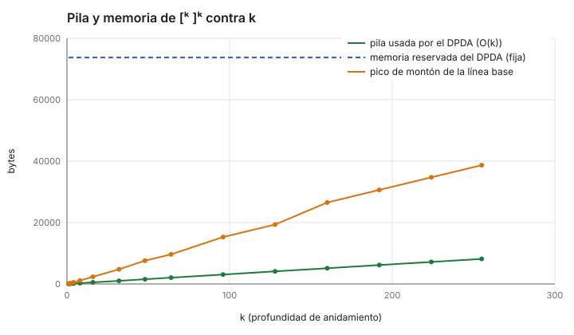
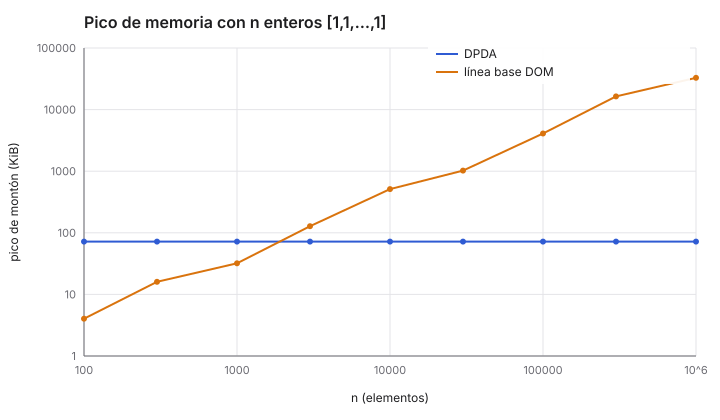
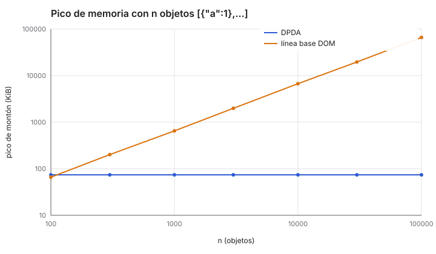
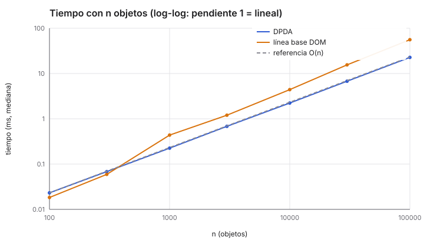

# Fase 6 — Validación en tiempo real

> Enunciado, §3: «Modo streaming por bloques, error con ruta JSON Pointer y posición en bytes, manejo de payloads
> malformados y límites de profundidad, tamaño y tiempo; instrumentación en vivo de MB/s, ciclos por byte, pico de
> memoria, asignaciones, profundidad de pila y tamaño del autómata (estados y transiciones), con línea base de DOM +
> validador genérico.»

Código: `crates/runtime-rs` (`core.rs`, `limits.rs`), `crates/codegen` (los `main` generados), `crates/baseline`
(líneas base), `crates/bench` (arnés de métricas, bombeo y gráficas) y `fuzz/` (cargo-fuzz).

## 1. Streaming por bloques

El validador es incremental: `feed(bloque)` acepta bloques de **cualquier** tamaño y `finish()` cierra la entrada.
Todo el estado cabe en la memoria fija que presta el llamador (`sv_state_t` en C), así que:

- **no hay búfer del payload**: cada byte entra una vez al lexer y cada evento una vez a δ (Fase 4 §2);
- **el resultado no depende de cómo se parta la entrada**: la prueba diferencial de la Fase 5 y las pruebas de
  bombeo lo comprueban con bloques de 1, 7 y 4 096 bytes;
- **fallo temprano**: si el payload ya está mal formado o pasó un límite (peso ∞), `sv_feed` devuelve −1 y el
  llamador puede dejar de leer. El `main` generado lee stdin por bloques y se detiene ahí.

El servidor de la Fase 7 usa el mismo núcleo para validar en vivo por WebSocket, bloque a bloque.

## 2. Reporte de error: posición y JSON Pointer

El reporte (`runtime_rs::Report`, `sv_report_t`) da, del **primer** error:

| Campo | Contenido |
| --- | --- |
| `valid`, `violations` | veredicto y peso (`null` si es ∞) |
| `errorKind` | `lexical`, `syntax`, `schema`, `limit` o `internal` |
| `offset`, `line`, `column` | posición en **bytes** desde el inicio (exacta, `u64`) y línea y columna en puntos de código |
| `pointer` | ruta en la **instancia**: un JSON Pointer (RFC 6901, con `~0` y `~1`) en JSON; una ruta de nombres de elemento (`/pedido/linea`) en XML |
| `pointerTruncated` | si el puntero pasó de 1 024 bytes (`POINTER_MAX`) y se recortó |
| `rule`, `keyword` | ubicación de la regla en el **esquema** (`#/$defs/node/properties/value`) y su palabra clave |

El puntero se reconstruye **desde la pila**: cada marco abierto sabe qué clave o qué índice lo abrió, así que no
hace falta guardar el camino aparte. Ejemplos reales:

```
{"valid":false,"violations":2,"errorKind":"schema","offset":36,"line":1,"column":37,
 "pointer":"/children/0/value","rule":"#/$defs/node/properties/value","keyword":"type"}

{"valid":false,"violations":null,"errorKind":"syntax","offset":26,"line":1,"column":27,"pointer":"/children/0"}
```

## 3. Payloads malformados

Un payload mal formado tiene peso ∞ y se reporta en el primer byte que lo delata:

| Causa | Dónde se detecta | `errorKind` |
| --- | --- | --- |
| UTF-8 inválido, controles en cadenas, escapes o números mal formados | lexer (Fase 1) | `lexical` |
| `<!DOCTYPE`, entidad no predefinida, referencia inválida | lexer XML | `lexical` |
| token inesperado (`{"a" 1}`, `[1,]`, payload truncado) | entrada `ERROR` de δ | `syntax` |
| clave declarada repetida | `Fail(Duplicate)` en δ | `syntax` |
| clave no declarada o atributo repetidos, nombre de cierre distinto | capa de buena formación del núcleo | `syntax` |

## 4. Límites

Pasar un límite es un error `limit` de peso ∞ **en el evento que lo pasa**: nunca un pánico ni una reserva. Valores
por defecto (`Limits::DEFAULT`), configurables al emitir con `schemac compile --limit nombre=valor` o en
`sv_limits_t` al llamar a `sv_init`:

| `--limit` | Qué acota | Por defecto |
| --- | --- | --- |
| `maxDepth` | anidamiento de objetos y arreglos (o de elementos XML) | 256 |
| `maxString` | bytes de una cadena, un nombre, un valor de atributo o un tramo de texto | 1 MiB |
| `maxLexeme` | bytes del lexema de un número que leen las comprobaciones numéricas | 1 024 |
| `maxKeys` | claves no declaradas por objeto guardadas para detectar repetidas | 1 024 |
| `keyPool` | esas claves entre todos los objetos abiertos | 4 096 |
| `maxUnique` | elementos de los arreglos con `uniqueItems` abiertos a la vez | 4 096 |
| `maxXmlRefs` | referencias de entidad o de carácter por documento XML | 100 000 |
| `maxPayload` | bytes del payload | sin límite (*streaming*) |
| `maxTimeMs` | tiempo de pared | sin límite en la biblioteca |

**El tiempo no lo vigila la biblioteca**, porque es `no_std` y no tiene reloj. Lo vigila quien la alimenta: el
`main` generado comprueba `maxTimeMs` entre bloques y llama a `sv_abort_limit`, y el servidor pone 10 s por
petición. Como la validación es O(n), el tiempo solo depende del tamaño del payload, que también se puede acotar.

La **memoria** que necesita el validador sale de los límites al compilar (`Tables::state_words`, que se emite como
`SV_STATE_WORDS`). Con los valores por defecto son **72–78 KiB** en todo el corpus, sea cual sea el tamaño del
payload.

## 5. Instrumentación y línea base

### 5.1 Línea base: DOM + validador genérico

`crates/baseline` construye **el árbol entero** del payload y lo valida después, en dos pasadas:

- **JSON:** `serde_json` (DOM) + `jsonschema` (Draft 2020-12, sin red, `format` como anotación y un motor de
  `pattern` lineal), más la detección de claves repetidas y la profundidad 256, que se añadieron para comparar lo
  mismo.
- **XML:** libxml2 (DOM + XSD 1.0, sin red, sin DTD ni entidades), detrás de la *feature* `libxml2` y ejecutado en
  Docker (`make test-baseline-xml`), porque necesita libxml2, `pkg-config` y libclang.

Sirve de **oráculo** (corpus, generadores, mutaciones y fuzzing) y de **comparación de costo**.

### 5.2 Arnés

```
cargo run -p bench --release --bin metricas                # corpus + bombeo
cargo run -p bench --release --bin metricas -- --corpus
cargo run -p bench --release --bin metricas -- --bombeo-fino --csv bombeo.csv
cargo run -p bench --release --bin graficas -- bombeo.csv docs/tecnica/graficas
```

Por cada caso mide, para el DPDA (alimentado en bloques de 4 KiB) y para la línea base:

| Métrica | Cómo |
| --- | --- |
| MB/s y ns/byte | mediana del tiempo de validar, sin compilar el esquema |
| ciclos por byte | ns/byte × GHz de la máquina (leer contadores de ciclos exigiría `unsafe`) |
| asignaciones y pico de memoria | `dhat` como asignador global, en una validación |
| profundidad | anidamiento máximo del payload, calculado sin recursión |
| tamaño de M | estados y transiciones |

Las mediciones de tiempo viven solo aquí: `cargo test` no tiene umbrales de tiempo, para que las pruebas sean
deterministas.

### 5.3 Resultados (medidos al escribir este documento)

Windows 11, compilación `--release`, intérprete de M. Los tiempos absolutos dependen de la máquina; lo que importa
es la **forma** de las curvas.

**Corpus** (94 casos). El DPDA hace **1 asignación** por validación en todos los casos (el búfer de memoria fija que
reserva el arnés; el núcleo no reserva nada) y su pico es de 72–78 KiB. M más grande del corpus: 444 estados y
21 141 transiciones. La línea base JSON corre en 73 casos (los XML necesitan libxml2 en Docker), y en los 73 da el
**mismo veredicto** que el DPDA.

**Bombeo** (`[ᵏ ]ᵏ`, arreglos de n enteros y de n objetos):

| Caso | Bytes | DPDA: pico | DPDA: asign. | Línea base: pico | Línea base: asign. |
| --- | ---: | ---: | ---: | ---: | ---: |
| `[ᵏ ]ᵏ`, k = 255 | 510 | 72,0 KiB | 1 | 37,8 KiB | 262 |
| 10⁶ enteros | 2 000 001 | 72,0 KiB | 1 | 32,0 MiB | 20 |
| 10⁵ objetos | 800 001 | 74,0 KiB | 1 | 64,4 MiB | 200 017 |

| Caso | DPDA MB/s | DPDA ns/byte | Línea base MB/s | Línea base ns/byte |
| --- | ---: | ---: | ---: | ---: |
| 10⁶ enteros | 26,8 | 37,3 | 57,1 | 17,5 |
| 10⁵ objetos | 35,3 | 28,3 | 14,5 | 69,1 |

![Tiempo contra k en [ᵏ ]ᵏ](graficas/anidado-tiempo.svg)





Los valores dibujados están en [graficas/datos.md](graficas/datos.md).

**Lectura.**

- **Memoria.** La del DPDA es **constante** (72–74 KiB, fijada por los límites) y la de la línea base crece con n:
  64,4 MiB con 10⁵ objetos. Es la diferencia entre O(d) y O(n).
- **Pila.** La del DPDA es lineal en la profundidad: 32 bytes por nivel en `[ᵏ ]ᵏ` (8 160 B con k = 255), dentro de
  la memoria fija.
- **Tiempo.** Lineal en los dos. Con objetos el DPDA es ~2,5× más rápido, porque la línea base reserva un nodo por
  valor (200 017 asignaciones). Con un arreglo plano de enteros la línea base es ~2× más rápida que el **intérprete**,
  porque `serde_json` parsea enteros con un camino muy optimizado y el DPDA pasa cada byte del número por el lexer y
  por δ.

## 6. Pruebas de bombeo

`crates/bench/tests/bombeo.rs` comprueba el lema de bombeo sin medir tiempo, solo con veredictos, pesos y la pila:

| Prueba | Qué muestra |
| --- | --- |
| `anidado_se_acepta_para_todo_k_hasta_el_tope` | u·vᵏ·x·yᵏ·z con v = `[`, y = `]` es válido para todo k ≤ 256 |
| `bombear_solo_v_o_solo_y_rompe_la_palabra` | bombear solo `[` o solo `]` da un payload malformado: es lo que hace un AFD, y por eso no reconoce el lenguaje |
| `pasar_el_tope_de_profundidad_es_un_limite` | k = 257 es un error `limit`, no un desbordamiento |
| `pila_lineal_en_k_y_memoria_fija` | la pila crece con k y la memoria total no |
| `bombear_una_violacion_suma_k_en_el_semianillo_tropical` | con `items: {maximum: 5}` y v = `9,`, el peso es **exactamente k**: ⊗ es la suma |
| `bombeo_con_v_e_y_no_vacios_y_recursion` | v = `[9,`, y = `]` sobre un esquema recursivo: k violaciones en k niveles |
| `bloques_de_cualquier_tamano_dan_lo_mismo` | el veredicto no depende del tamaño de los bloques |

## 7. Casos extremos y fuzzing

**Extremos del corpus.** `extreme-big-number-01` es un número de 1 025 bytes, que pasa `maxLexeme`:
`limit`. `extreme-depth-01` son 257 arreglos anidados: `limit` en el byte 256 (el `[` número 257).
`malformed-xml-billion-laughs-01` y `malformed-xml-dtd-doctype-01` se rechazan con un error léxico en la `D` de
`<!DOCTYPE` (byte 24), **antes** de declarar ninguna entidad. Los payloads grandes se generan (`generator`), no se
versionan.

**Fuzzing** (`fuzz/`, cargo-fuzz con *nightly*, `make fuzz`). Cinco objetivos:

| Objetivo | Propiedad |
| --- | --- |
| `esquema_json`, `esquema_xsd`, `esquema_dtd` | ningún esquema hace entrar en pánico ni desborda la pila a las Fases 2-4; lo prohibido (`<!ENTITY`, `<!DOCTYPE`…) nunca llega a la IR; si M se construye, cumple las propiedades comunes |
| `validar_json` | payloads arbitrarios contra esquemas que cubren todas las estrategias, con la línea base DOM como oráculo: mismo veredicto, mismo número de violaciones y un puntero compatible |
| `validar_xml` | payloads XML arbitrarios: propiedades comunes; la equivalencia con el C se reproduce en la prueba diferencial |

## 8. Mitigaciones

| Amenaza | Mitigación en el código |
| --- | --- |
| **ReDoS en `pattern`** | lo no regular (retrorreferencias, *lookaround*, perezosos) se rechaza en la Fase 3; lo demás es un AFD (Fase 4 §5): una transición por carácter, sin retroceso. `^(a+)+b$` compila a 4 estados |
| **Explosión al determinizar** | topes de 4 096 posiciones o estados, presupuestos de δ y de trabajo, todos comprobados **antes** de reservar (Fase 4 §9) |
| **Desbordamiento de pila por anidamiento** | validador: la pila es memoria del llamador con tope `maxDepth`. Compilador: parsers con profundidad ≤ 256 en hilos de 8 MiB; todo lo demás con pilas explícitas |
| **XXE y *billion laughs*** | `<!DOCTYPE` y las entidades no predefinidas son errores **léxicos** en payloads y esquemas XSD; en las DTD, `<!ENTITY`, `<![` y `%` también; tope de 100 000 referencias de carácter |
| **`$ref` cíclicos** | ciclos no productivos rechazados (Tarjan, Fase 3 §4); los productivos son recursión con pila acotada |
| **Números enormes** | el lexema se compara con aritmética decimal exacta; más de 1 024 bytes es `limit` |
| ***Hash flooding*** | SipHash-1-3 con clave aleatoria en los binarios y en el compilador (`RandomState`) |
| **Ejecución de código generado** | compilación y ejecución en un sandbox Docker sin red, sin root y de solo lectura, con límites de CPU, memoria, procesos y tiempo (Fase 7 §4) |
